# KẾ HOẠCH TRIỂN KHAI: BẢNG THÀNH TÍCH, BIỂU ĐỒ TIẾN ĐỘ, CHUỖI NGÀY HỌC & SỔ CÁI XP (USER PROGRESS DASHBOARD & GAMIFICATION LEDGER)

- **Mã tính năng:** `FEAT-GAMIFICATION-AND-PROGRESS`
- **Tài liệu tham chiếu:** [.agents/specs/gamification-and-progress.spec.md](file:///d:/English-Speaking-AI-Web-App/.agents/specs/gamification-and-progress.spec.md)
- **Stitch Project:** `projects/4941763722361833280`
- **Stitch Screen:** `projects/4941763722361833280/screens/fee2e11619e74f5bb400ef5026f45bc7` (`User Progress Dashboard & Gamification Ledger`)
- **Design System Asset:** `assets/11193421007380981584` (`AI Speaking Tutor 3D Luxury Design System`)
- **Active Branch:** `feature/gamification-and-progress`
- **Trọng tâm hiệu năng:** Pure SVG Math Server-Calculated, SSR/SSG Core Shell, FCP < 0.6s, LCP < 0.8s, Tuyệt đối **0KB Three.js**.

---

## 1. SƠ ĐỒ BỐ CỤC WIREFRAME (GOOGLE STITCH UI BLUEPRINT)

Dựa trên cấu trúc trích xuất từ màn hình Stitch Screen `fee2e11619e74f5bb400ef5026f45bc7`, giao diện Bảng điều khiển tiến độ `/progress` được thiết kế theo tỷ lệ chuẩn Desktop hiển thị 16:10, phân chia thành 5 phân khu chức năng cao cấp trên nền Dark Slate Luxury (`#131722` / `oklch(0.16 0.02 260)`):

### 1.1. Bố Cục Tổng Thể Desktop (>= 1280px)

```text
+------------------------------------------------------------------------------------------------------------------------+
|  [Logo AI Speaking 3D]       [Luyện Tập 3D]   [Bản Đồ IPA & Bài Học]   [Tiến Độ & Thành Tích (Active)]                 |
+------------------------------------------------------------------------------------------------------------------------+
|                                                                                                                        |
|  [KHU VỰC 1: PROGRESS HEADER BAR & VOCAL TIER BANNER]                                                                  |
|  +------------------------------------------------------------------------------------------------------------------+  |
|  | [💎 Level 4: Vocal Apprentice]   Thanh XP: [==============------] 1,850 / 2,500 XP (74%)   [🔥 7 Ngày Chuỗi]    |  |
|  | 32/44 Âm đã làm chủ              Độ chuẩn tổng quát: 78.4% (Emerald)                   [🛡️ Bảo Vệ Chuỗi: 1 Có Sẵn]  |  |
|  +------------------------------------------------------------------------------------------------------------------+  |
|                                                                                                                        |
|  +-- CỘT TRÁI (60% WIDTH): NĂNG LỰC NGỮ ÂM & TIẾN TRÌNH -------+  +-- CỘT PHẢI (40% WIDTH): GAMIFICATION & VINH DANH -+ |
|  |                                                             |  |                                                    | |
|  |  [KHU VỰC 2: BIỂU ĐỒ RADAR 6 TRỤC (PURE SVG 0KB THREE.JS)]  |  |  [KHU VỰC 4: BẢNG XẾP HẠNG HỌC VIÊN (LEADERBOARD)] | |
|  |  +-------------------------------------------------------+  |  |  +----------------------------------------------+ | |
|  |  |                 [Nguyên Âm (Vowels - 84%)]            |  |  |  | [Tab 1: Tuần Này (Active)] [Tab 2: Toàn Bộ]   | | |
|  |  |                        / \                            |  |  |  |                                              | | |
|  |  |   [Âm Tiếp Cận 81%]  /     \  [Âm Tắc (Plosives 85%)] |  |  |  |    🥈 #2 Alexandre T.       🥇 #1 Minh Anh (RP)  | | |
|  |  |          |          /       \          |              |  |  |  |     (4,210 XP)               (4,820 XP)          | | |
|  |  |          |         <  Polygon >        |              |  |  |  |                 🥉 #3 Thu Hà (3,950 XP)      | | |
|  |  |   [Âm Mũi 92%]       \     /  [Âm Xát 48% (Cần Luyện)]|  |  |  |  --------------------------------------------  | | |
|  |  |                        \ /                            |  |  |  |  📌 #14 Bạn (You) - 1,850 XP (+3 hạng)        | | |
|  |  |                [Âm Tắc Xát (72%)]                     |  |  |  |     (Cách Top 10 vỏn vẹn 210 XP)             | | |
|  |  +-------------------------------------------------------+  |  |  +----------------------------------------------+ | |
|  |                                                             |  |                                                    | |
|  |  [KHU VỰC 3: ĐƯỜNG XU HƯỚNG PHÁT ÂM 30 NGÀY (TRENDLINE SVG)]|  |  [KHU VỰC 5: KHO HUY HIỆU & SỔ CÁI BIẾN ĐỘNG XP]   | |
|  |  +-------------------------------------------------------+  |  |  +----------------------------------------------+ | |
|  |  | 100% |                                                 |  |  |  | HUY HIỆU DANH GIÁ:                          | | |
|  |  |  85% | - - - Oxford RP Benchmark - - - - - - - - - - - |  |  |  | [🏆 7-Day Flame] [🎯 Sniper] [🗣️ Twister]    | | |
|  |  |  78% |                 .-.       .-.  (Hôm nay: 78.4%) |  |  |  | [🔒 Level 10 Virtuoso (4%)] [🔒 Accent C2]    | | |
|  |  |  62% |       .-.      /   \  .-./   \                  |  |  |  |                                              | | |
|  |  |      +--/---\----/-----\---'-------------------------  |  |  |  | SỔ CÁI BẤT BIẾN (XP LEDGER RECENT):          | | |
|  |  |        1    5   10    15   20   25   30 Ngày           |  |  |  | - +50 XP: Luyện bài Minimal Pair /θ/ vs /t/  | | |
|  |  |        [Vùng Gradient Fill OKLCH mềm mại]             |  |  |  | - +100 XP: Thưởng Chuỗi 7 Ngày Học Liên Tục   | | |
|  |  +-------------------------------------------------------+  |  |  | - 🛡️ 0 XP: Đóng băng bảo vệ chuỗi (Freeze)   | | |
|  |                                                             |  |  | [Xem toàn bộ lịch sử sổ cái (Slide Drawer) ->]| | |
|  |                                                             |  |  +----------------------------------------------+ | |
|  +-------------------------------------------------------------+  +----------------------------------------------------+ |
+------------------------------------------------------------------------------------------------------------------------+
```

---

## 2. SƠ ĐỒ TUẦN TỰ DỮ LIỆU (MERMAID SEQUENCE DIAGRAM)

Luồng xử lý từ lúc học viên phát âm đạt chuẩn đến khi chuỗi Streak tăng, XP được cộng dồn theo giao dịch ACID có khóa dòng `SELECT ... FOR UPDATE`, và mở khóa danh hiệu:

```mermaid
sequenceDiagram
    autonumber
    actor Learner as Học Viên (Client)
    participant API as /api/practice/assess
    participant Normalizer as Timezone & Streak Normalizer
    participant Repo as ProgressRepository (ACID)
    participant DB as PostgreSQL 16 (user_stats & xp_ledger)
    participant AchieveEngine as Achievement Unlock Engine
    participant DashboardSSR as Server Component (/progress)

    Learner->>API: Gửi Audio Blob & Idempotency Key (POST)
    API->>API: AI Chấm điểm âm vị (Overall >= 6000, Duration >= 1000ms)

    rect rgb(20, 25, 40)
        Note over API,DB: GIAO DỊCH ACID & KHÓA DÒNG BI QUAN
        API->>Repo: recordProgressAndAwardXp(userId, xpDelta, attemptId, idempotencyKey)
        Repo->>DB: BEGIN TRANSACTION (READ COMMITTED)
        Repo->>DB: SELECT * FROM user_stats WHERE user_id = $1 FOR UPDATE
        DB-->>Repo: Trả về total_xp, streak, version, last_active_date

        Repo->>Normalizer: calculateStreak(lastActiveDate, clientTimezone, freezesAvailable)
        Normalizer-->>Repo: { newStreak, newLongest, usedFreeze, freezeDeduction }

        Repo->>DB: SELECT 1 FROM xp_ledger WHERE idempotency_key = $key
        alt Trùng lặp Idempotency
            DB-->>Repo: Đã tồn tại bản ghi
            Repo->>DB: ROLLBACK (Early Return Idempotent)
        else Hợp lệ mới
            Repo->>DB: INSERT INTO xp_ledger (amount, balance_after, source, idempotency_key...)
            Repo->>DB: UPDATE user_stats SET total_xp, streak, version = version + 1...
            Repo->>DB: COMMIT TRANSACTION
        end
    end

    rect rgb(30, 20, 40)
        Note over API,AchieveEngine: ĐÁNH GIÁ MỞ KHÓA DANH HIỆU ĐỒNG BỘ
        API->>AchieveEngine: evaluateCriteria(userId, currentStats)
        AchieveEngine->>DB: SELECT criteria FROM achievements WHERE not_unlocked_yet
        AchieveEngine-->>API: Danh hiệu mới mở khóa: [7-Day Flame (+100 XP)]
        alt Có mở khóa danh hiệu
            API->>Repo: recordAchievementXp(userId, achievementId, 100 XP)
        end
    end

    API-->>Learner: 200 OK { score, newTotalXp, newStreak, unlockedBadges }

    rect rgb(15, 30, 25)
        Note over Learner,DashboardSSR: TRUY XUẤT DASHBOARD SSR (0KB THREE.JS)
        Learner->>DashboardSSR: Truy cập /progress
        DashboardSSR->>DB: Truy vấn song song (User Stats, Mastery 44 âm, Attempts 30d, Top 50 Leaderboard)
        DashboardSSR->>DashboardSSR: Tính toán tọa độ Pure SVG (Polygon 6 trục & Đường cong Bezier 30 ngày)
        DashboardSSR-->>Learner: HTML Stream siêu tốc (TTFB < 150ms, FCP < 0.6s, LCP < 0.8s)
    end
```



---

## 3. DANH SÁCH FILE TẠO MỚI & CHỈNH SỬA (SURGICAL DIFFS)

### 3.1. DTOs & Domain Schemas
- `src/core/dto/progress.dto.ts` *(Tạo mới)*: Định nghĩa Zod v4 schemas cho `UserLevelSchema`, `PhonemeRadarAxisSchema`, `ProgressTrendPointSchema`, `AchievementItemSchema`, `LeaderboardDataSchema`, `UserProgressDashboardSchema`.
- `src/core/domain/streak-calculator.ts` *(Tạo mới)*: Domain logic tính toán chuỗi ngày học theo múi giờ IANA, xử lý Streak Freeze, phòng chống gian lận.
- `src/core/domain/level-calculator.ts` *(Tạo mới)*: Công thức toán học bậc hai tính Level, XP thresholds và % tiến độ.

### 3.2. Repositories & Database Layer
- `src/core/repositories/progress-repository.ts` *(Tạo mới)*: Contract interface & In-memory/Postgres implementation với khóa dòng `SELECT ... FOR UPDATE`, bảo toàn ACID, chống trùng lặp `idempotency_key`.
- `src/core/repositories/achievement-repository.ts` *(Tạo mới)*: Contract & Implementation truy vấn tiêu chí danh hiệu JSONB và lưu vết mở khóa.
- `src/core/services/progress-service.ts` *(Tạo mới)*: Service điều phối tổng hợp dữ liệu Dashboard cá nhân hóa.
- `src/core/services/leaderboard-service.ts` *(Tạo mới)*: Service tính toán xếp hạng Tuần / All-Time với window function `DENSE_RANK()`.

### 3.3. Frontend SVG Geometry & UI Micro-Components
- `src/modules/progress/utils/radar-geometry.ts` *(Tạo mới)*: Hàm toán học tính toán tọa độ cực 6 trục sang Descartes cho đa giác SVG.
- `src/modules/progress/utils/trendline-geometry.ts` *(Tạo mới)*: Hàm nội suy đường cong Bezier khối bậc 3 cho đường xu hướng 30 ngày.
- `src/modules/progress/components/ProgressHeader.tsx` *(Tạo mới)*: Level badge, thanh XP tiến độ, ngọn lửa Streak và nút đóng băng chuỗi.
- `src/modules/progress/components/PhonemeRadarCard.tsx` *(Tạo mới)*: Thẻ hiển thị Radar Chart Pure SVG với Design DNA OKLCH (0KB Three.js).
- `src/modules/progress/components/ProgressTrendCard.tsx` *(Tạo mới)*: Thẻ hiển thị biểu đồ xu hướng 30 ngày Pure SVG kèm Oxford RP Benchmark.
- `src/modules/progress/components/MiniLeaderboardCard.tsx` *(Tạo mới)*: Thẻ Bảng xếp hạng Tuần/All-Time, Top 3 Podiums và vị trí người dùng ghim nổi bật.
- `src/modules/progress/components/AchievementsBadgeGrid.tsx` *(Tạo mới)*: Lưới hiển thị danh hiệu vàng ánh kim và huy hiệu đang khóa.
- `src/modules/progress/components/XpLedgerHistoryDrawer.tsx` *(Tạo mới)*: Slide-over drawer hiển thị biến động số dư sổ cái bất biến.
- `src/modules/progress/components/StreakFreezeModal.tsx` *(Tạo mới)*: Modal giải cứu chuỗi ngày học khi có gián đoạn.
- `src/modules/progress/components/ProgressSkeleton.tsx` *(Tạo mới)*: Skeleton loading giữ CLS = 0.00 cho Server Component streaming.

### 3.4. App Routes
- `src/app/progress/page.tsx` *(Tạo mới)*: Server Component điều phối tải dữ liệu SSR song song và render Dashboard.
- `src/app/progress/loading.tsx` *(Tạo mới)*: Suspense Loading fallback.
- `src/app/progress/leaderboard/page.tsx` *(Tạo mới)*: Trang Bảng xếp hạng chi tiết Top 100 học viên toàn quốc.

### 3.5. Chỉnh sửa nhẹ nhàng (Surgical Edit)
- `src/app/api/practice/assess/route.ts` *(Surgical Edit)*: Gọi tích hợp `ProgressRepository` để cập nhật streak và kiểm tra mở khóa danh hiệu sau khi chấm điểm thành công.
- `src/app/page.tsx` *(Surgical Edit)*: Cập nhật link điều hướng menu sang `/progress`.

### 3.6. Automated Test Suite (TDD Red-to-Green)
- `tests/unit/streak-calculator.test.ts` *(Tạo mới)*: Kiểm thử múi giờ, đứt chuỗi, giải cứu bằng Streak Freeze, chặn attempt < 6000 điểm.
- `tests/unit/level-calculator.test.ts` *(Tạo mới)*: Kiểm thử công thức toán học tính Cấp độ 1..10+ và % XP.
- `tests/unit/radar-geometry.test.ts` *(Tạo mới)*: Kiểm thử tọa độ toán học SVG 6 trục đảm bảo không vượt quá viewBox.
- `tests/unit/trendline-geometry.test.ts` *(Tạo mới)*: Kiểm thử sinh đường cong Bezier mềm mại.
- `tests/integration/xp-ledger-acid.test.ts` *(Tạo mới)*: Kiểm thử tranh chấp đồng thời (Concurrency), Rollback khi gặp lỗi, Idempotency.
- `tests/integration/leaderboard.test.ts` *(Tạo mới)*: Kiểm thử tính toán DENSE_RANK tuần và toàn thời gian.
- `tests/acceptance/progress-dashboard.test.tsx` *(Tạo mới)*: Kiểm thử component Dashboard render đầy đủ 5 phân khu.
- `tests/acceptance/bundle-isolation.test.ts` *(Surgical Edit)*: Bổ sung guardrail xác minh `/progress` tuyệt đối không import Three.js (0KB Three.js bundle).

---

## 4. KẾ HOẠCH PHÂN KỲ TRIỂN KHAI (PHASED EXECUTION)

### Phase 1: Domain Logic, DTOs & Pure Math Formulas (TDD Red)
1. Tạo `src/core/dto/progress.dto.ts` với đầy đủ Zod v4 schemas.
2. Viết unit tests cho Level & Progression: `tests/unit/level-calculator.test.ts`.
3. Viết unit tests cho Streak & Timezone: `tests/unit/streak-calculator.test.ts`.
4. Cài đặt `level-calculator.ts` và `streak-calculator.ts` -> Chuyển test sang **Green**.

### Phase 2: Backend ACID Engine & Repository Layer (TDD Red-to-Green)
1. Viết integration test `tests/integration/xp-ledger-acid.test.ts` mô phỏng:
   - 2 request đồng thời cộng XP vào 1 user.
   - Retry request với cùng idempotency key.
   - Giả lập lỗi DB giữa chừng để kiểm tra Rollback toàn vẹn.
2. Triển khai `ProgressRepository` và `AchievementRepository` (In-memory + SQL statements).
3. Chạy `npx vitest run tests/integration/xp-ledger-acid.test.ts` -> Chuyển sang **Green 100%**.

### Phase 3: Pure SVG Geometry & Micro-Components (0KB Three.js)
1. Viết unit test cho toán học hình học SVG: `tests/unit/radar-geometry.test.ts` và `tests/unit/trendline-geometry.test.ts`.
2. Triển khai `radar-geometry.ts` và `trendline-geometry.ts` (Green).
3. Xây dựng các micro-components:
   - `ProgressHeader.tsx`
   - `PhonemeRadarCard.tsx` (Pure SVG 6 trục)
   - `ProgressTrendCard.tsx` (Pure SVG Bezier 30 ngày)
   - `MiniLeaderboardCard.tsx`
   - `AchievementsBadgeGrid.tsx`
   - `XpLedgerHistoryDrawer.tsx`
   - `StreakFreezeModal.tsx`
   - `ProgressSkeleton.tsx`
4. Dựng trang Server Component `src/app/progress/page.tsx` và `loading.tsx`.

### Phase 4: Leaderboard, Acceptance Test & Bundle Isolation Guardrail
1. Viết integration test `tests/integration/leaderboard.test.ts` kiểm thử window function `DENSE_RANK()`.
2. Viết acceptance test `tests/acceptance/progress-dashboard.test.tsx`.
3. Cập nhật `tests/acceptance/bundle-isolation.test.ts` kiểm tra AST của `/progress` và `src/modules/progress` không rò rỉ `three`.
4. Chạy toàn bộ test suite dự án: `npm test` -> Đảm bảo **toàn bộ bài test xanh (Green 100%)**.
5. Kiểm tra TypeScript: `npm run typecheck` (0 errors).
6. Kiểm tra ESLint: `npm run lint` (0 warnings).

---

## 5. TIÊU CHUẨN CHẤP NHẬN & CAM KẾT READ-ONLY

- Bản kế hoạch này duy trì trạng thái **READ-ONLY**, không làm thay đổi bất kỳ file mã nguồn logic nào của dự án tại Giai đoạn 3.
- Toàn bộ thiết kế bám sát Wireframe Google Stitch Screen `fee2e11619e74f5bb400ef5026f45bc7` và Design System Token `assets/11193421007380981584`.
- Sẵn sàng kích hoạt Giai đoạn 4 ngay sau khi được Tech Lead phê duyệt.
