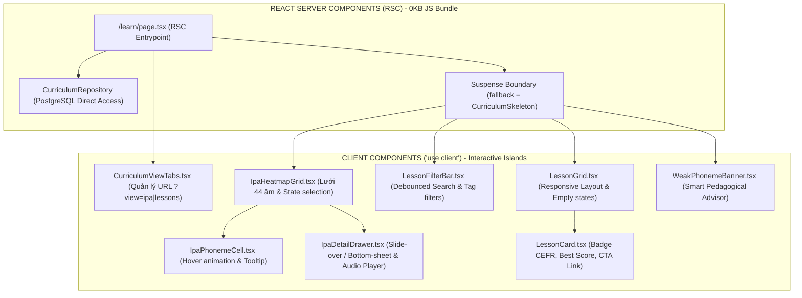
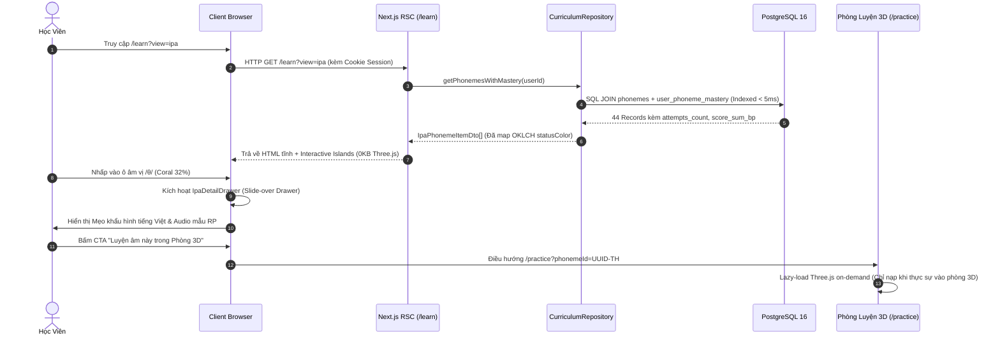

# KẾ HOẠCH TRIỂN KHAI: BẢN ĐỒ 44 ÂM VỊ IPA & PHÂN HỆ DANH MỤC BÀI HỌC CEFR (CURRICULUM & IPA HEATMAP)

- **Mã tính năng:** `FEAT-IPA-MAP-AND-LESSONS`
- **Tài liệu tham chiếu:** `.agents/specs/ipa-map-and-lessons.spec.md`
- **Stitch Project:** `projects/4941763722361833280`
- **Stitch Screen:** `projects/4941763722361833280/screens/0ffff379a743401993838d5ad83b028e` (`Curriculum & 44 IPA Phoneme Heatmap`)
- **Design System Asset:** `assets/11193421007380981584` (`AI Speaking Tutor 3D Luxury Design System`)
- **Active Branch:** `feature/ipa-map-and-lessons`
- **Trọng tâm hiệu năng:** SSR Core Shell, TTFB < 150ms, FCP < 0.6s, LCP < 0.8s, CLS = 0.00, Tuyệt đối **0KB Three.js**.

---

## 1. SƠ ĐỒ BỐ CỤC WIREFRAME (GOOGLE STITCH UI BLUEPRINT)

### 1.1. Bố Cục Desktop (>= 1280px)

```text
+------------------------------------------------------------------------------------------------------------------------+
|  [Logo AI Speaking 3D]       [Luyện Tập]   [Bản Đồ IPA & Bài Học (Active)]   [Bảng Thành Tích]      [Streak 7d 🔥] [XP 1,250] |
+------------------------------------------------------------------------------------------------------------------------+
|                                                                                                                        |
|  TIÊU ĐỀ: TRUNG TÂM HỌC LIỆU NGỮ ÂM & LỘ TRÌNH CEFR                                                                    |
|  Mô tả: Nâng cao độ chuẩn xác ngữ âm Anh - Anh qua bản đồ nhiệt 44 âm IPA và bài học khắc phục tật phát âm             |
|                                                                                                                        |
|  [ TAB 1: Bản Đồ 44 Âm IPA (/learn?view=ipa) (Active) ]     [ TAB 2: Danh Mục Bài Học CEFR (/learn?view=lessons) ]       |
+------------------------------------------------------------------------------------------------------------------------+
|                                                                                                                        |
|  [VIEW 1: BẢN ĐỒ NHIỆT 44 ÂM VỊ IPA]                                                                                   |
|                                                                                                                        |
|  +-- PHÂN KHU 1: NGUYÊN ÂM ĐƠN (MONOPHTHONGS - 12 ÂM) ---------------------------------------------------------------+ |
|  |  Độ mở hàm / Vị trí lưỡi       Front (Trước)         Central (Giữa)        Back (Sau)                             | |
|  |  Close / High (Đóng/Cao)       [ /iː/ (Emerald 88%) ]  [              ]      [ /uː/ (Emerald 82%) ]               | |
|  |                                [ /ɪ/  (Amber 68%)   ]  [              ]      [ /ʊ/  (Coral 45%)   ]               | |
|  |  Mid (Vừa)                     [ /e/  (Amber 74%)   ]  [ /ə/  (Slate --) ]  [ /ɔː/ (Emerald 85%) ]               | |
|  |                                [                    ]  [ /ɜː/ (Slate --) ]  [                    ]               | |
|  |  Open / Low (Mở/Thấp)          [ /æ/  (Coral 38%)   ]  [ /ʌ/  (Slate --) ]  [ /ɑː/ (Amber 62%)   ]               | |
|  |                                [                    ]  [              ]      [ /ɒ/  (Slate --)   ]               | |
|  +-------------------------------------------------------------------------------------------------------------------+ |
|                                                                                                                        |
|  +-- PHÂN KHU 2: NGUYÊN ÂM ĐÔI (DIPHTHONGS - 8 ÂM) ------------------------------------------------------------------+ |
|  |  Centring (Hướng về /ə/):     [ /ɪə/ (Amber 65%) ]   [ /eə/ (Coral 42%) ]   [ /ʊə/ (Slate --) ]                   | |
|  |  Closing (Hướng về /ɪ/ & /ʊ/): [ /eɪ/ (Emerald 90%) ] [ /aɪ/ (Emerald 86%) ] [ /ɔɪ/ (Amber 71%) ]                 | |
|  |                               [ /əʊ/ (Coral 52%) ]   [ /aʊ/ (Emerald 84%) ]                                       | |
|  +-------------------------------------------------------------------------------------------------------------------+ |
|                                                                                                                        |
|  +-- PHÂN KHU 3: PHỤ ÂM (CONSONANTS - 24 ÂM SẮP XẾP THEO CẶP VÔ THANH / HỮU THANH) ----------------------------------+ |
|  |  Plosives (Tắc):              [ /p/ (92%) | /b/ (88%) ]   [ /t/ (75%) | /d/ (82%) ]   [ /k/ (89%) | /ɡ/ (81%) ]   | |
|  |  Fricatives (Xát - Trọng tâm): [ /f/ (94%) | /v/ (80%) ]   [ /θ/ (32% - Coral) | /ð/ (41% - Coral) ]              | |
|  |                               [ /s/ (85%) | /z/ (78%) ]   [ /ʃ/ (62%) | /ʒ/ (55%) ]   [ /h/ (96%) ]               | |
|  |  Affricates (Tắc xát):        [ /tʃ/ (64%) | /dʒ/ (58%) ]                                                         | |
|  |  Nasals & Approximants:       [ /m/ (95%) ]  [ /n/ (91%) ]  [ /ŋ/ (68%) ]  [ /l/ (73%) ]  [ /r/ (79%) ]           | |
|  |                               [ /w/ (88%) ]  [ /j/ (86%) ]                                                        | |
|  +-------------------------------------------------------------------------------------------------------------------+ |
+------------------------------------------------------------------------------------------------------------------------+
```

### 1.2. Slide-over Drawer Chi Tiết Âm Vị (`IpaDetailDrawer`)

```text
+-------------------------------------------------------------+
|  [X Đóng]                                                   |
|                                                             |
|  KÝ HIỆU IPA:  /θ/           VOICELESS DENTAL FRICATIVE    |
|  Ví dụ kinh điển: "think" [θɪŋk], "three", "healthy"        |
|                                                             |
|  MỨC ĐỘ THÀNH THẠO HIỆN TẠI:                                |
|  [ Coral Badge: 32.00% - Cần Cải Thiện ]                    |
|  Đã luyện: 18 lượt  |  Đạt chuẩn: 4 lượt                    |
|                                                             |
|  NGHE PHÁT ÂM MẪU CHUẨN ANH - ANH (British RP):             |
|  [ ▶ Phát Giọng Mẫu (Sonia RP) ]  ============O==== 0:02    |
|                                                             |
|  HƯỚNG DẪN KHẨU HÌNH CHO NGƯỜI VIỆT (ARTICULATION GUIDE):    |
|  - Đặt nhẹ đầu lưỡi vào giữa hai hàm răng trên và dưới.     |
|  - Thổi luồng hơi ma sát thoát ra qua khe hở đầu lưỡi.      |
|  - Dây thanh KHÔNG rung (âm vô thanh).                      |
|                                                             |
|  LỖI ĐẶC TRƯNG NGƯỜI VIỆT HAY MẮC (COMMON SUBSTITUTIONS):   |
|  - ❌ Thường bị đọc thành /s/ ("xinh" thay vì "think").     |
|  - ❌ Thường bị đọc thành /t/ ("tinh" thay vì "think").     |
|                                                             |
|  HÀNH ĐỘNG TIẾP THEO:                                       |
|  [ 🚀 LUYỆN ÂM NÀY TRONG PHÒNG 3D (/practice?phonemeId=...) ]|
|  [ 📚 Xem 4 bài học chứa âm này (/learn?view=lessons...)   ] |
+-------------------------------------------------------------+
```

### 1.3. Bố Cục Danh Mục Bài Học CEFR & Tật Phát Âm (`/learn?view=lessons`)

```text
+------------------------------------------------------------------------------------------------------------------------+
|  [ GỢI Ý SƯ PHẠM CÁ NHÂN HÓA - SMART PEDAGOGICAL ADVISOR ]                                                             |
|  ⚡ Âm /θ/ của bạn đang đạt 32% (Coral). Luyện ngay: "Bài 3: Cặp âm xát răng Think & Three" để bứt phá điểm số!         |
|  [ Luyện bài này ngay -> ]                                                                                             |
+------------------------------------------------------------------------------------------------------------------------+
|  THANH BỘ LỌC ĐA CHIỀU (LESSON FILTER BAR):                                                                            |
|  [ 🔍 Tìm kiếm từ vựng, tên bài... ]                                                                                   |
|  Trình độ CEFR:  [ Tất cả ] [ A1 ] [ A2 ] [ B1 (Active) ] [ B2 ] [ C1 ] [ C2 ]                                         |
|  Nhóm tật VN:    [ Tất cả ] [ #Mất_Âm_Đuôi ] [ #Xát_Răng_/θ/-/ð/ (Active) ] [ #Uốn_Lưỡi ] [ #Nguyên_Âm_Dài_Ngắn ]       |
+------------------------------------------------------------------------------------------------------------------------+
|  DANH SÁCH BÀI HỌC (LƯỚI RESPONSIVE 3 CỘT):                                                                           |
|                                                                                                                        |
|  +-- LESSON CARD 1 -------------------+  +-- LESSON CARD 2 -------------------+  +-- LESSON CARD 3 -------------------+|
|  | [B1] [ #Xát_Răng ]      [ 50 XP ]  |  | [B1] [ #Xát_Răng ]      [ 60 XP ]  |  | [A2] [ #Mất_Âm_Đuôi ]   [ 40 XP ]  ||
|  | Dental Fricatives: /θ/ vs /ð/      |  | Tongue Twister: Thirty-Three      |  | Final Consonant Clust: -ts, -ps   ||
|  | Phân biệt cặp âm xát răng vô/hữu   |  | Thử thách phát âm 33 tên trộm      |  | Tránh nuốt âm đuôi trong câu      ||
|  | ⏱ 12 phút   | Âm trọng tâm: /θ/ /ð/|  | ⏱ 15 phút   | Âm trọng tâm: /θ/    |  | ⏱ 10 phút   | Âm: /s/, /t/, /p/   ||
|  | Điểm cao nhất: 42% (Coral)         |  | Điểm cao nhất: Chưa học (Slate)    |  | Điểm cao nhất: 85% (Emerald 👑)    ||
|  | [ Vào Phòng Luyện 3D -> ]          |  | [ Vào Phòng Luyện 3D -> ]          |  | [ Luyện Lại Bài Này -> ]           ||
|  +------------------------------------+  +------------------------------------+  +------------------------------------+|
+------------------------------------------------------------------------------------------------------------------------+
```

### 1.4. Bố Cục Mobile (< 768px)
- **Top Bar:** Sticky gọn gàng, nút chuyển View dạng Segmented Control full-width.
- **Bản Đồ IPA:** Tự động chuyển thành cuộn ngang có chỉ dẫn (Horizontal Scroll) hoặc Accordion từng phân khu (Nguyên âm đơn -> Nguyên âm đôi -> Phụ âm).
- **Slide-over Drawer:** Biến đổi thành Bottom Sheet trượt lên từ đáy màn hình (`max-h-[85vh]`, bo tròn góc trên `rounded-t-2xl`).
- **Lesson Filter:** Dropdown select cho CEFR và Chip Bar cuộn ngang cho nhóm tật người Việt. Thẻ bài học xếp chồng 1 cột (`w-full`).

---

## 2. KIẾN TRÚC SUB-COMPONENTS & PHÂN ĐỊNH RANH GIỚI (RSC VS CLIENT)



### Bảng Phân Công Nhiệm Vụ & Props Của Sub-components

| Component | Ranh giới | Props chính | State nội bộ & Hooks | Trách nhiệm cốt lõi |
| :--- | :--- | :--- | :--- | :--- |
| `src/app/learn/page.tsx` | **RSC** | `searchParams: Promise<{ view, cefr, category, search, phonemeId }>` | Không có | Server-render shell tĩnh, giải nén params, gọi Repository với user ID từ session, streaming render Suspense. |
| `CurriculumViewTabs` | **Client** | `activeView: 'ipa' \| 'lessons'` | `useRouter`, `useSearchParams` | Render segmented control chuyển đổi giữa Bản đồ IPA và Danh mục bài học, đồng bộ URL `?view=...`. |
| `IpaHeatmapGrid` | **Client** | `phonemes: IpaPhonemeItemDto[]` | `selectedPhoneme: IpaPhonemeItemDto \| null` | Vẽ lưới 3 phân khu IPA chuẩn ngữ âm học, tính toán màu OKLCH, kích hoạt Drawer khi click ô âm vị. |
| `IpaPhonemeCell` | **Client** | `phoneme: IpaPhonemeItemDto`, `onSelect: () => void` | `isHovered: boolean` | Hiển thị ký hiệu IPA (Charis SIL), chip điểm số, viền màu Design DNA, âm thanh hover nhẹ. |
| `IpaDetailDrawer` | **Client** | `phonemeId: string \| null`, `isOpen: boolean`, `onClose: () => void` | `audioPlaying: boolean`, `drawerData` (fetch on demand) | Slide-over drawer bên phải màn hình: audio RP phát âm mẫu, mẹo khẩu hình tiếng Việt, lỗi hay gặp, 2 CTA. |
| `LessonFilterBar` | **Client** | `currentFilters: LessonCatalogFilterDto` | `searchTerm: string`, `useDebounce` | Thanh tìm kiếm tức thời + Bộ lọc nút bấm CEFR (A1-C2) + Chip nhóm tật người Việt; cập nhật URL query. |
| `LessonCard` | **Client** | `lesson: LessonCardDto` | Không có | Thẻ bài học chuẩn Awwwards: badge CEFR, điểm kỷ lục (vòng cung điểm), thời lượng, chip âm trọng tâm, CTA vào `/practice`. |
| `WeakPhonemeBanner` | **Client** | `weakestPhoneme: IpaPhonemeItemDto \| null` | `isDismissed: boolean` | Phân tích âm vị điểm thấp nhất của học viên, hiển thị thông điệp sư phạm cá nhân hóa và nút dẫn thẳng vào bài học. |
| `CurriculumSkeleton` | **RSC/Client**| Không có | Không có | Render khung skeleton với kích thước khớp 100% layout thật, triệt tiêu hoàn toàn Layout Shift (CLS = 0.00). |

---

## 3. SƠ ĐỒ TUẦN TỰ LUỒNG DỮ LIỆU & ĐIỀU HƯỚNG (MERMAID)



---

## 4. KẾ HOẠCH TRIỂN KHAI THEO GIAI ĐOẠN 4 (TDD RED-TO-GREEN ROADMAP)

### Lượt 1: Backend TDD Red-to-Green (Data Layer & Services)
1. **Bước 1 (DTOs & Validation):**
   - Tạo file `src/core/dto/curriculum.dto.ts` định nghĩa Zod schemas: `IpaPhonemeItemSchema`, `LessonCardSchema`, `LessonCatalogFilterSchema`, `PhonemeDetailDrawerSchema`.
2. **Bước 2 (Unit Test & Integration Test - RED):**
   - Tạo file `tests/unit/curriculum-service.test.ts` kiểm thử logic tính toán điểm trung bình, gán màu OKLCH, và thuật toán tìm âm vị yếu nhất.
   - Tạo file `tests/integration/curriculum-repository.test.ts` kiểm thử truy vấn PostgreSQL thực tế (Seed 44 âm vị, tính toán điểm từ `user_phoneme_mastery`, lọc bài học theo CEFR và tags).
3. **Bước 3 (Triển khai Repository & Service - GREEN):**
   - Viết `src/core/repositories/curriculum-repository.ts` với các query SQL tối ưu index đã nêu trong Spec.
   - Viết `src/core/services/curriculum-service.ts` xử lý business logic và bảo vệ SLA.
   - Chạy `npx vitest run tests/unit/curriculum-service.test.ts tests/integration/curriculum-repository.test.ts` -> 100% Pass.

### Lượt 2: Frontend SSR/SSG Siêu Tốc (0KB Three.js & Design DNA)
1. **Bước 1 (Unit Test Chống Rò Rỉ Three.js - RED):**
   - Tạo file `tests/unit/bundle-isolation.test.ts`: Quét file import dependency của module `/learn` và `src/modules/curriculum`, khẳng định không dính chuỗi `three`, `@react-three/fiber`, hay `@react-three/drei`.
2. **Bước 2 (Xây dựng Sub-components UI):**
   - Tạo các micro-components trong `src/modules/curriculum/components/`:
     - `CurriculumViewTabs.tsx`
     - `IpaPhonemeCell.tsx` & `IpaHeatmapGrid.tsx`
     - `IpaDetailDrawer.tsx`
     - `LessonCard.tsx` & `LessonGrid.tsx`
     - `LessonFilterBar.tsx`
     - `WeakPhonemeBanner.tsx`
     - `CurriculumSkeleton.tsx`
3. **Bước 3 (Xây dựng Entrypoint Server Component):**
   - Tạo `src/app/learn/page.tsx` và `src/app/learn/loading.tsx`.
   - Cập nhật điều hướng Navbar tại `src/app/page.tsx` và `src/app/layout.tsx` dẫn tới `/learn`.
4. **Bước 4 (Chạy Toàn Bộ Kiểm Thử & Kiểm Tra Build):**
   - `npm test` -> Toàn bộ Unit, Integration & Isolation tests pass.
   - `npm run typecheck` -> 0 lỗi TypeScript.
   - `npm run lint` -> 0 warnings.
   - `npm run build` -> Biên dịch thành công, xác nhận kích thước JS của `/learn` đạt chuẩn < 80KB.

---

## 5. MA TRẬN FILE THAY ĐỔI (FILE CHANGE MATRIX)

| Hành động | Đường dẫn file | Mục đích |
| :--- | :--- | :--- |
| **CREATE** | `src/core/dto/curriculum.dto.ts` | Zod schemas & TypeScript types cho âm vị, bài học, bộ lọc. |
| **CREATE** | `src/core/repositories/curriculum-repository.ts` | Repository truy vấn PostgreSQL tối ưu cho danh mục & bản đồ IPA. |
| **CREATE** | `src/core/services/curriculum-service.ts` | Domain service tính toán điểm trung bình, màu sắc, âm vị yếu nhất. |
| **CREATE** | `src/app/learn/page.tsx` | React Server Component chính cho route `/learn`. |
| **CREATE** | `src/app/learn/loading.tsx` | Loading skeleton toàn trang chống CLS. |
| **CREATE** | `src/modules/curriculum/components/CurriculumViewTabs.tsx` | Điều hướng Tab chuyển đổi giữa Bản đồ IPA và Danh mục bài học. |
| **CREATE** | `src/modules/curriculum/components/IpaHeatmapGrid.tsx` | Khung lưới 44 âm vị IPA 3 phân khu. |
| **CREATE** | `src/modules/curriculum/components/IpaPhonemeCell.tsx` | Từng ô âm vị với token màu OKLCH Design DNA. |
| **CREATE** | `src/modules/curriculum/components/IpaDetailDrawer.tsx` | Slide-over drawer chi tiết âm vị, audio mẫu và CTA 3D. |
| **CREATE** | `src/modules/curriculum/components/LessonFilterBar.tsx` | Thanh lọc bài học theo CEFR, nhóm tật VN, từ khóa. |
| **CREATE** | `src/modules/curriculum/components/LessonGrid.tsx` | Lưới hiển thị bài học responsive. |
| **CREATE** | `src/modules/curriculum/components/LessonCard.tsx` | Thẻ bài học chuẩn Luxury Awwwards. |
| **CREATE** | `src/modules/curriculum/components/WeakPhonemeBanner.tsx` | Banner sư phạm gợi ý âm vị yếu nhất. |
| **CREATE** | `src/modules/curriculum/components/CurriculumSkeleton.tsx` | Skeleton loading khớp pixel layout. |
| **CREATE** | `src/modules/curriculum/hooks/useCurriculumFilters.ts` | Custom hook đồng bộ bộ lọc với URL Search Params. |
| **CREATE** | `tests/unit/curriculum-service.test.ts` | Unit test cho business logic tính điểm & phân loại màu. |
| **CREATE** | `tests/unit/bundle-isolation.test.ts` | Guardrail test bảo đảm 0KB Three.js cho route `/learn`. |
| **CREATE** | `tests/integration/curriculum-repository.test.ts` | Integration test truy vấn database PostgreSQL thực tế. |
| **SURGICAL EDIT** | `src/app/page.tsx` | Cập nhật liên kết nút "Khám Phá Bản Đồ IPA" dẫn thẳng tới `/learn`. |
| **SURGICAL EDIT** | `PROJECT_STATE.md` | Cập nhật tiến độ sau khi hoàn thành Giai đoạn 3 & 4. |

---

> [!IMPORTANT]
> **XÁC NHẬN DUYỆT KẾ HOẠCH (APPROVAL REQUIRED):**
> Vui lòng phản hồi **"Duyệt"** (hoặc bổ sung yêu cầu chỉnh sửa) để tôi bắt đầu bước vào **Giai đoạn 4 - Lượt 1: Backend TDD Red-to-Green**!
