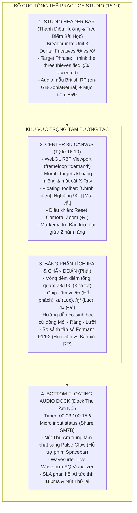
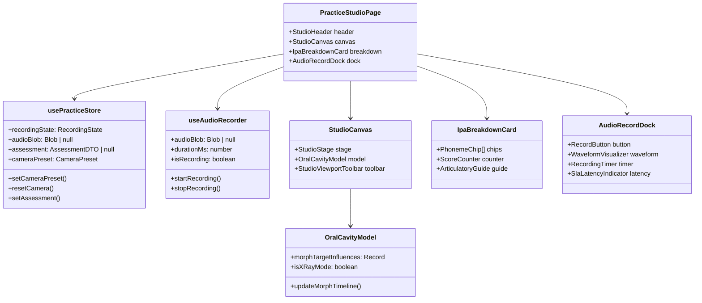
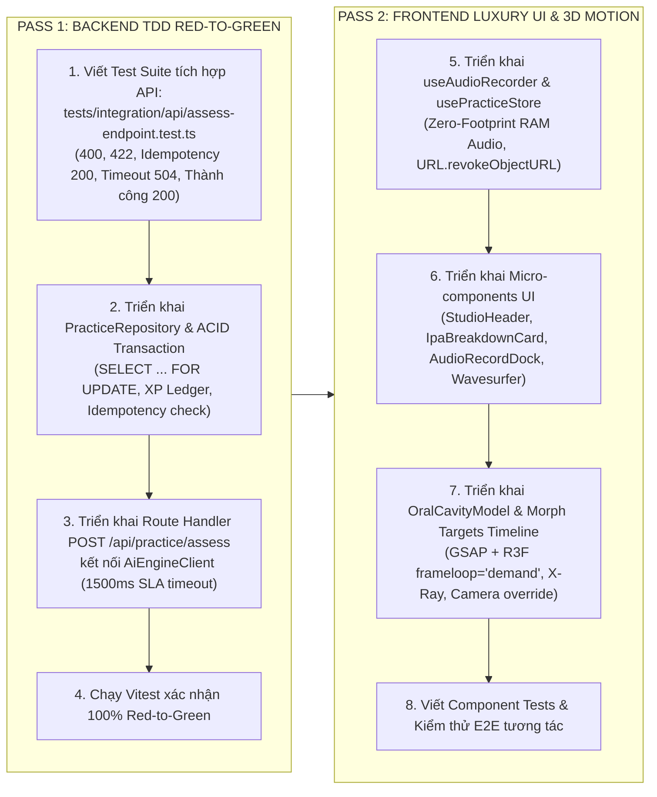

# KẾ HOẠCH TRIỂN KHAI: PHÒNG LUYỆN PHÁT ÂM 3D (PRACTICE STUDIO)

- **Mã tính năng:** `FEAT-PRACTICE-STUDIO-3D`
- **Tài liệu tham chiếu:** `.agents/specs/practice-studio-3d.spec.md`
- **Stitch Project:** `projects/4941763722361833280`
- **Stitch Screen:** `projects/4941763722361833280/screens/111d95d95fd34e2ea30b76c5b79718e1`
- **Design System Asset:** `assets/11193421007380981584` (`AI Speaking Tutor 3D Luxury Design System`)

---

## 1. SƠ ĐỒ BỐ CỤC WIREFRAME TỪ GOOGLE STITCH

Màn hình được thiết kế theo tỷ lệ chuẩn Desktop hiển thị 16:10, phân chia thành 4 khu vực chức năng chính với độ tương phản cao trên nền dark-mode luxury (`#131722` / `oklch(0.16 0.02 260)`):

### Bảng Phân Tách Lưới Giao Diện (Layout Matrix)

| Khu Vực | Component | Grid / Flexbox Classes | Đặc Điểm Kỹ Thuật |
| :--- | :--- | :--- | :--- |
| **Top** | `StudioHeader` | `flex items-center justify-between h-16 px-6 border-b border-border-subtle/60` | Sticky top, typography chuẩn Be Vietnam Pro, hiển thị ký tự phiên âm IPA chuẩn Charis SIL. |
| **Center-Left** | `StudioCanvasContainer` | `relative aspect-[16/10] w-full lg:w-2/3 rounded-2xl overflow-hidden border border-border-subtle` | Chứa Canvas 3D R3F, camera overlay bar, Draggable OrbitControls, X-Ray view switch. |
| **Center-Right** | `IpaBreakdownCard` | `flex flex-col gap-4 w-full lg:w-1/3 p-6 rounded-2xl bg-surface border border-border-subtle` | Hiển thị score badge 0..100, phoneme feedback tokens (Green `>=85`, Amber `70..84`, Red `<70`). |
| **Bottom** | `AudioRecordDock` | `fixed bottom-6 inset-x-0 mx-auto max-w-4xl p-4 rounded-full bg-surface-raised/80 backdrop-blur-xl border border-border-subtle` | Zero-Footprint RAM recording, live waveform visualization, phím tắt `Spacebar`, SLA badge. |

---

## 2. DANH SÁCH MICRO-COMPONENTS CẦN XÂY DỰNG

### Danh mục chi tiết các tệp mã nguồn:

1. **State & Audio Hooks:**
   - `src/modules/practice-studio/stores/usePracticeStore.ts`: Quản lý trạng thái tương tác toàn cục (chế độ camera, timeline playback, kết quả chấm điểm, idempotencyKey).
   - `src/modules/practice-studio/hooks/useAudioRecorder.ts`: Hook quản lý Web Audio API (MediaRecorder PCM 16kHz Mono), timer đếm ngược 15s, tự động thu hồi `URL.revokeObjectURL()` tránh rò rỉ RAM.

2. **3D Scene & Articulators:**
   - `src/modules/practice-studio/three/OralCavityModel.tsx`: Render giải phẫu vòm miệng/răng/lưỡi với các morph targets (`jawOpen`, `tongueInterdental`, `lipPucker`) và shader vật liệu mặt cắt trong suốt X-Ray.
   - `src/modules/practice-studio/three/StudioViewportToolbar.tsx`: Thanh công cụ nổi trên 3D Canvas (chuyển góc quay Frontal, Profile 90°, Cross-Section, nút Reset View, zoom).

3. **Giao Diện Học Tập & Phân Tích Âm Tiết:**
   - `src/modules/practice-studio/components/StudioHeader.tsx`: Header hiển thị câu mục tiêu, phiên âm IPA với font Charis SIL, nút nghe âm thanh bản xứ RP.
   - `src/modules/practice-studio/components/IpaBreakdownCard.tsx`: Bảng phân tích chi tiết từng âm vị, hiển thị màu sắc trạng thái tương phản cao và chỉ dẫn giải phẫu vị trí lưỡi/răng.

4. **Âm Thanh & Điều Khiển Thu Âm:**
   - `src/modules/practice-studio/components/AudioWaveformVisualizer.tsx`: Tích hợp Wavesurfer.js trực quan hóa sóng âm thanh thời gian thực.
   - `src/modules/practice-studio/components/AudioRecordDock.tsx`: Dock thu âm nổi phía dưới màn hình, nút bấm mic dạng Pulse Motion, bộ đếm thời gian và nhãn SLA latency.

5. **Backend Route Handler & Database Services:**
   - `src/app/api/practice/assess/route.ts`: Route handler xử lý multipart audio + JSON metadata, kiểm tra Idempotency, khóa dòng `SELECT ... FOR UPDATE` trên `user_stats`, gọi AI engine với timeout 1500ms, commit ACID PostgreSQL.
   - `src/core/repositories/practice-repository.ts`: Data access layer cho `practice_attempts`, `attempt_phoneme_results`, `user_stats`, `xp_ledger`.
   - `src/core/adapters/ai-engine-client.ts`: Client adapter giao tiếp với Python FastAPI (WhisperX + Wav2Vec2) với cơ chế timeout ngắt kết nối `AbortController`.

---

## 3. THỨ TỰ VÀ LỘ TRÌNH TRIỂN KHAI (IMPLEMENTATION ROADMAP)

### Chi Tiết Từng Giai Đoạn

#### Giai Đoạn 1: Backend TDD Red-to-Green (Pass 1)
1. **Kiểm thử trước (Red Test):**
   - Tạo file kiểm thử tích hợp `tests/integration/api/assess-endpoint.test.ts`.
   - Kiểm chứng đầy đủ ma trận lỗi:
     - `HTTP 400 Bad Request`: Payload thiếu file audio hoặc JSON metadata sai định dạng.
     - `HTTP 422 Unprocessable Entity`: Audio quá ngắn (< 0.5s) hoặc vượt quá 15s.
     - `HTTP 200 OK (Idempotent)`: Gửi lại cùng `idempotencyKey` trả về ngay kết quả cũ mà không tính toán lại hoặc nhân đôi XP.
     - `HTTP 504 Gateway Timeout`: Giả lập AI Engine phản hồi > 1500ms, đảm bảo attempt lưu trạng thái `failed` với `SCORING_TIMEOUT` và không cộng trừ XP.
     - `HTTP 200 OK (Thành công)`: Lưu chi tiết điểm âm vị, cộng dồn XP và cập nhật chuỗi streak trong transaction ACID.
2. **Cài đặt Logic & Repository (Green Phase):**
   - Xây dựng `src/core/repositories/practice-repository.ts` và `src/core/adapters/ai-engine-client.ts`.
   - Viết mã xử lý cho `src/app/api/practice/assess/route.ts`.
3. **Thẩm định (Refactor & Verify):**
   - Chạy `npm test` và `npm run typecheck` để bảo đảm không có lỗi typing hoặc hồi quy mã nguồn.

#### Giai Đoạn 2: Frontend Luxury UI & 3D Motion (Pass 2)
1. **Âm thanh In-Memory & Quản lý State:**
   - Xây dựng `useAudioRecorder` với Web Audio API và `MediaRecorder`.
   - Kết nối `usePracticeStore` (Zustand) để điều phối giữa trạng thái thu âm, điểm số và 3D viewport.
2. **Xây dựng Micro-Components Giao Diện:**
   - Tạo `StudioHeader`, `IpaBreakdownCard` (màu trạng thái Xanh `#22C55E`, Hổ phách `#F59E0B`, Đỏ `#EF4444`, font Charis SIL).
   - Tạo `AudioRecordDock` với hiệu ứng vòng sáng thở (breathing pulse) bằng Framer Motion/CSS và tích hợp Wavesurfer.js.
3. **Mô Hình 3D Morph Targets & Timeline Khẩu Hình:**
   - Tạo `OralCavityModel` hỗ trợ Morph Targets (hàm, răng, lưỡi) và chế độ mặt cắt X-Ray.
   - Kết nối timeline GSAP với `invalidate()` trên R3F `frameloop="demand"` để bảo đảm 60 FPS mượt mà khi nghe mẫu hoặc phát lại kết quả.
   - Thêm bộ điều khiển camera presets (`Frontal`, `Profile 90°`, `Cross-Section`) và cơ chế tự ngắt tween khi người dùng kéo chuột tương tác thủ công.
4. **Kiểm thử giao diện:**
   - Viết component unit tests cho `IpaBreakdownCard` và `AudioRecordDock`.
   - Chạy kiểm thử toàn diện `npm test`, `npm run lint`, `npm run typecheck`.
