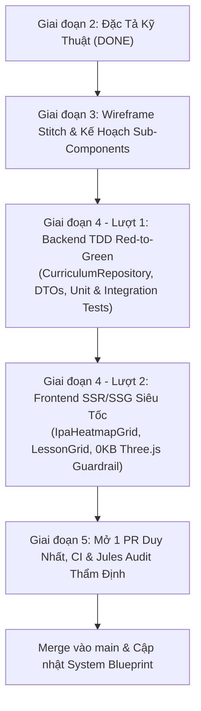

# ĐẶC TẢ KỸ THUẬT: BẢN ĐỒ 44 ÂM VỊ IPA & PHÂN HỆ DANH MỤC BÀI HỌC CEFR (SSR/SSG CORE SHELL — 0KB THREE.JS)

- **Mã tính năng:** `FEAT-IPA-MAP-AND-LESSONS`
- **Phiên bản:** `1.0.0`
- **Trạng thái:** `APPROVED`
- **Tác giả:** Lead Systems Architect & Educational Product Lead
- **Mục tiêu:** Cung cấp trung tâm học liệu tải siêu tốc (FCP < 0.6s, LCP < 0.8s, 0KB Three.js bundle) gồm: (1) Bản đồ nhiệt trực quan hóa mức độ thành thạo 44 âm vị IPA theo Design DNA (Emerald/Amber/Coral); (2) Danh mục bài học phân tầng theo khung tham chiếu châu Âu CEFR (A1-C2) và 5 nhóm tật phát âm người Việt; (3) Cầu nối điều hướng tức thì vào Phòng Luyện Phát Âm 3D (`/practice`).

---

## 1. USER STORIES & TIÊU CHÍ CHẤP NHẬN (ACCEPTANCE CRITERIA)

### US-1: Bản Đồ Nhiệt 44 Âm Vị IPA (IPA Heatmap Matrix)
- **User Story:** Là một học viên, tôi muốn quan sát tổng thể 44 âm vị tiếng Anh và nhìn thấy ngay những âm mình phát âm chuẩn (xanh), âm còn lệch nhẹ (vàng) và âm thường xuyên phát âm sai (đỏ) để biết điểm yếu cần khắc phục.
- **AC-1.1 (Cấu trúc Lưới Chuẩn IPA Quốc Tế):**
  - **Given:** Người dùng truy cập tab Bản đồ IPA tại `/learn?view=ipa`.
  - **When:** Lưới 44 âm vị được render.
  - **Then:** Bản đồ được chia thành 3 phân khu chuẩn ngữ âm học:
    1. *Monophthongs (12 nguyên âm đơn):* Sắp xếp theo ma trận Vị trí lưỡi (Front - Central - Back) x Độ mở hàm (High - Mid - Low).
    2. *Diphthongs (8 nguyên âm đôi):* Sắp xếp theo hướng trượt âm (Centring diphthongs kết thúc bằng /ə/, Closing diphthongs kết thúc bằng /ɪ/ hoặc /ʊ/).
    3. *Consonants (24 phụ âm):* Sắp xếp theo Place of Articulation (Môi, Răng, Ngạc, Thanh hầu...) x Manner of Articulation (Tắc, Xát, Tắc xát, Mũi, Tiếp cận...), phân tách trực quan giữa âm Vô thanh (Unvoiced) và Hữu thanh (Voiced).
- **AC-1.2 (Quy Tắc Phân Màu Nhiệt Design DNA & Toán Học Điểm Số):**
  - **Given:** Dữ liệu âm vị kết hợp giữa bảng `phonemes` và `user_phoneme_mastery` của học viên.
  - **When:** Hệ thống tính toán điểm trung bình `avg_score_bp`:
    - Nếu `attempts_count == 0`: Trạng thái **Neutral Slate** (`bg-slate-900/40 text-slate-400 border-white/10`), hiển thị biểu tượng sẵn sàng khám phá, không tính điểm.
    - Nếu `attempts_count > 0`: `avg_score_bp = Number(score_sum_bp / BigInt(attempts_count))`.
  - **Then:** Màu sắc được gán chuẩn xác theo token OKLCH:
    - `avg_score_bp >= 8000` (>= 80.00%): **Emerald / Green** (`bg-emerald-500/10 text-emerald-400 border-emerald-500/30 hover:border-emerald-400/60`).
    - `6000 <= avg_score_bp < 8000` (60.00% - 79.99%): **Amber / Yellow** (`bg-amber-500/10 text-amber-400 border-amber-500/30 hover:border-amber-400/60`).
    - `0 < avg_score_bp < 6000` (< 60.00%): **Coral / Red** (`bg-rose-500/10 text-rose-400 border-rose-500/30 hover:border-rose-400/60`).
- **AC-1.3 (Slide-over Drawer Khám Phá Âm Vị & CTA Chuyển Tiếp):**
  - **Given:** Học viên nhấp vào bất kỳ ô âm vị nào trên lưới.
  - **When:** Sự kiện click kích hoạt.
  - **Then:** Component `IpaDetailDrawer` trượt vào từ cạnh phải màn hình (hoặc modal ở mobile), hiển thị:
    1. Ký hiệu IPA lớn (phông `Charis SIL`), phân loại âm (Voiced/Unvoiced, Place/Manner).
    2. Điểm số cá nhân (`avg_score_bp / 100`%), số lượt đã luyện tập (`attempts_count`), số lượt đạt chuẩn (`correct_count`).
    3. Từ ví dụ kinh điển (e.g., `/θ/` -> *"think"*, `/æ/` -> *"cat"*).
    4. Trình phát audio phát âm mẫu British RP chuẩn (`reference_voice` hoặc audio mẫu lưu sẵn) với nút Play/Stop mượt mà, giải phóng tài nguyên ngay lập tức.
    5. Mẹo đặt khẩu hình độc quyền cho người Việt (`articulation_guide_vi`).
    6. Danh sách các âm người Việt hay phát âm nhầm (`common_vn_substitutions`, ví dụ `/θ/` -> hay đọc nhầm thành `/s/` hoặc `/t/`).
    7. **2 Nút CTA chiến lược:**
       - CTA 1: *"Luyện Âm Này Trong Phòng 3D"* -> Điều hướng `/practice?phonemeId={id}`.
       - CTA 2: *"Xem Các Bài Học Chứa Âm Này"* -> Chuyển tab sang `/learn?view=lessons&phonemeId={id}`.

---

### US-2: Phân Hệ Danh Mục Bài Học CEFR & Nhóm Tật Phát Âm Người Việt
- **User Story:** Là một học viên, tôi muốn lọc và tìm kiếm bài học theo trình độ CEFR hoặc theo đúng nhóm lỗi phát âm đặc trưng của người Việt Nam (như mất âm đuôi, nhầm L/N, âm xát răng) để luyện tập có mục tiêu rõ ràng.
- **AC-2.1 (Phân Loại Taxonomy & Đồng Bộ URL Query Params):**
  - **Given:** Người dùng mở tab Danh mục bài học tại `/learn?view=lessons`.
  - **When:** Người dùng chọn bộ lọc CEFR hoặc nhóm tật phát âm.
  - **Then:** Trạng thái bộ lọc được đồng bộ hai chiều trực tiếp lên URL search parameters mà không làm reload lại toàn trang (hỗ trợ copy URL, bookmark, và back/forward history):
    - `cefr`: `all` | `A1` | `A2` | `B1` | `B2` | `C1` | `C2`.
    - `category`: `all` | `ending-consonants` | `dental-fricatives` | `palato-alveolar` | `vowel-length` | `regional-confusion` | slug danh mục từ bảng `lesson_categories`.
    - `search`: Từ khóa tìm kiếm theo tiêu đề bài học hoặc từ vựng.
    - `phonemeId`: Lọc các bài học có chứa âm vị trọng tâm (`is_focus = true`).
- **AC-2.2 (Thẻ Bài Học Chuẩn Luxury & Trạng Thái Cá Nhân Hóa):**
  - **Given:** Danh sách bài học tải về từ Server Component.
  - **When:** Thẻ `LessonCard` hiển thị.
  - **Then:** Thẻ bài học trình bày đầy đủ:
    1. Huy hiệu CEFR (`A1` Xanh ngọc, `B1` Cam hổ phách, `C1` Tím hoàng gia...).
    2. Nhãn chuyên đề hoặc tag tật phát âm (ví dụ: *#ÂmĐuôi*, *#XátRăng*).
    3. Tiêu đề song ngữ Anh - Việt và mô tả ngắn.
    4. Thời lượng ước tính (`estimated_minutes`) và phần thưởng XP (`xp_reward`).
    5. Danh sách chip âm vị trọng tâm (`focus_phonemes` ký hiệu IPA).
    6. Trạng thái cá nhân: Điểm cao nhất (`best_score_bp / 100`%), số lần đã làm (`attempts_count`), huy hiệu hoàn thành (Vương miện vàng nếu điểm >= 8000).
    7. Nút CTA *"Vào Luyện Tập"* -> Điều hướng `/practice?lessonId={id}`.
- **AC-2.3 (Banner Gợi Ý Sư Phạm Thông Minh - Smart Pedagogical Advisor):**
  - **Given:** Học viên đã thực hiện ít nhất 1 bài luyện tập trong hệ thống.
  - **When:** Trang `/learn` tải xong.
  - **Then:** Thuật toán tự động quét bảng `user_phoneme_mastery` tìm ra âm vị có điểm số thấp nhất (`min(avg_score_bp)`) hoặc âm vị thuộc nhóm tật người Việt thường mắc mà chưa đạt chuẩn (`avg_score_bp < 6000`).
  - **Then:** Banner đầu trang hiển thị thông điệp cá nhân hóa kèm nút hành động 1-click:
    - *Ví dụ:* *"Điểm phát âm âm /θ/ của bạn đang ở mức 35%. Hãy luyện ngay Bài học: 'Luyện Cặp Âm Xát Răng Think & Three' để tăng độ chuẩn xác!"* -> Bấm nút dẫn thẳng vào bài học.

---

### US-3: Hiệu Năng SSR/SSG & Streaming Suspense (Tải Siêu Tốc < 0.8s)
- **User Story:** Là một học viên, tôi muốn mở trang học liệu ngay tức khắc trên cả điện thoại di động và máy tính bảng mà không phải chờ nạp 3D nặng nề.
- **AC-3.1 (React Server Components & Streaming Architecture):**
  - **Given:** Request điều hướng tới `/learn`.
  - **When:** Máy chủ Next.js xử lý yêu cầu.
  - **Then:** 
    1. Shell tĩnh của trang (Header, Tab bar, Bộ lọc, Layout khung) được kết xuất tĩnh ngay lập tức với TTFB < 150ms.
    2. Phần dữ liệu cá nhân hóa (Bản đồ nhiệt và Danh sách bài học kèm điểm số học viên) được bao bọc trong `<Suspense fallback={<CurriculumSkeleton />}>`.
    3. Server Component truy vấn trực tiếp cơ sở dữ liệu PostgreSQL thông qua Repository chuyên biệt (`CurriculumRepository`), không qua vòng trung gian client fetch lãng phí.
- **AC-3.2 (Chỉ Số Hiệu Năng Cốt Lõi - Core Web Vitals Budget):**
  - **Given:** Đo kiểm hiệu năng bằng Lighthouse / Chrome DevTools Performance.
  - **Then:**
    - First Contentful Paint (FCP): `<= 0.6s`.
    - Largest Contentful Paint (LCP): `<= 0.8s`.
    - Cumulative Layout Shift (CLS): `0.00` (Không nhảy layout nhờ CSS Grid cố định và Skeleton kích thước chuẩn).
    - Interaction to Next Paint (INP): `<= 50ms`.

---

### US-4: Cô Lập Tuyệt Đối 0KB Three.js & Bundle Leak Prevention Guardrail
- **User Story:** Là Trưởng nhóm Kỹ thuật (Tech Lead), tôi muốn đảm bảo thư viện 3D (Three.js/R3F ~800KB) tuyệt đối không bị tải vào trang danh mục học liệu để bảo vệ băng thông và tốc độ tải trang.
- **AC-4.1 (Ranh Giới Module & Quy Ước Import):**
  - **Given:** Cây thư mục dự án Next.js App Router.
  - **When:** Module `/learn` được biên dịch.
  - **Then:** 
    1. Trang `/learn` và các component con trong `src/modules/curriculum/*` tuyệt đối KHÔNG import bất kỳ file nào từ `src/modules/practice-studio/three/*` hay các package `three`, `@react-three/fiber`, `@react-three/drei`, `three-stdlib`.
    2. Mọi kiểu dữ liệu dùng chung (Types, Enums, DTOs) bắt buộc phải import từ `src/core/dto/*` hoặc `src/core/domain/*`.
- **AC-4.2 (Unit Test Kiểm Tra Chống Rò Rỉ Tự Động Trong CI):**
  - **Given:** File kiểm thử tự động `tests/unit/bundle-isolation.test.ts`.
  - **When:** Lệnh `npm test` được thực thi trong CI.
  - **Then:** Test runner phân tích cây AST hoặc dependency graph của `src/app/learn` và `src/modules/curriculum`, xác nhận 100% không có sự hiện diện của `three` hay `@react-three`. Nếu phát hiện bất kỳ import nào, CI lập tức ngắt với exit code 1.

---

## 2. KIẾN TRÚC DỮ LIỆU & TRUY VẤN POSTGRESQL

### 2.1. DTOs & Validation Schemas (Zod v4)

```typescript
// src/core/dto/curriculum.dto.ts
import { z } from "zod";

export const PhonemeCategoryEnum = z.enum(["monophthong", "diphthong", "consonant"]);
export const CefrLevelEnum = z.enum(["A1", "A2", "B1", "B2", "C1", "C2"]);
export const FeedbackSeverityEnum = z.enum(["good", "minor", "major"]);

// DTO 1: Dữ liệu âm vị kèm trạng thái nhiệt cá nhân hóa
export const IpaPhonemeItemSchema = z.object({
  id: z.string().uuid(),
  ipaSymbol: z.string().min(1).max(8),
  arpabet: z.string().nullable(),
  category: PhonemeCategoryEnum,
  isVoiced: z.boolean(),
  placeOfArticulation: z.string().nullable(),
  mannerOfArticulation: z.string().nullable(),
  exampleWord: z.string(),
  sortOrder: z.number().int(),
  // Dữ liệu cá nhân hóa (từ user_phoneme_mastery)
  attemptsCount: z.number().int().nonnegative(),
  correctCount: z.number().int().nonnegative(),
  averageScoreBp: z.number().int().min(0).max(10000).nullable(), // null nếu attemptsCount == 0
  statusColor: z.enum(["neutral", "coral", "amber", "emerald"]),
  lastPracticedAt: z.string().datetime().nullable(),
});
export type IpaPhonemeItemDto = z.infer<typeof IpaPhonemeItemSchema>;

// DTO 2: Chi tiết Slide-over Drawer của âm vị
export const PhonemeDetailDrawerSchema = IpaPhonemeItemSchema.extend({
  articulationGuideVi: z.string(),
  commonVnSubstitutions: z.array(z.string()),
  relatedLessons: z.array(
    z.object({
      id: z.string().uuid(),
      slug: z.string(),
      titleEn: z.string(),
      titleVi: z.string(),
      cefr: CefrLevelEnum,
      xpReward: z.number().int(),
    })
  ),
});
export type PhonemeDetailDrawerDto = z.infer<typeof PhonemeDetailDrawerSchema>;

// DTO 3: Bộ lọc truy vấn danh mục bài học
export const LessonCatalogFilterSchema = z.object({
  cefr: z.union([CefrLevelEnum, z.literal("all")]).default("all"),
  categorySlug: z.string().default("all"),
  errorGroup: z.string().default("all"),
  search: z.string().optional(),
  phonemeId: z.string().uuid().optional(),
});
export type LessonCatalogFilterDto = z.infer<typeof LessonCatalogFilterSchema>;

// DTO 4: Thẻ bài học kèm tiến độ học viên
export const LessonCardSchema = z.object({
  id: z.string().uuid(),
  slug: z.string(),
  titleEn: z.string(),
  titleVi: z.string(),
  descriptionVi: z.string().nullable(),
  cefr: CefrLevelEnum,
  estimatedMinutes: z.number().int().positive(),
  xpReward: z.number().int().nonnegative(),
  tags: z.array(z.string()),
  categoryTitleVi: z.string(),
  focusPhonemes: z.array(
    z.object({
      id: z.string().uuid(),
      ipaSymbol: z.string(),
    })
  ),
  // Tiến độ học viên (từ user_lesson_progress)
  userProgress: z.object({
    bestScoreBp: z.number().int().min(0).max(10000),
    attemptsCount: z.number().int().nonnegative(),
    isCompleted: z.boolean(),
    completedAt: z.string().datetime().nullable(),
  }).nullable(),
});
export type LessonCardDto = z.infer<typeof LessonCardSchema>;
```

### 2.2. Truy Vấn Cơ Sở Dữ Liệu Tối Ưu (SQL Indices & Fast Queries)

#### Truy vấn 1: Bản Đồ 44 Âm Vị IPA Kèm Mức Độ Thành Thạo (Query time < 5ms)
```sql
SELECT 
  p.id,
  p.ipa_symbol,
  p.arpabet,
  p.category,
  p.is_voiced,
  p.place_of_articulation,
  p.manner_of_articulation,
  p.example_word,
  p.sort_order,
  COALESCE(upm.attempts_count, 0) AS attempts_count,
  COALESCE(upm.correct_count, 0) AS correct_count,
  CASE 
    WHEN COALESCE(upm.attempts_count, 0) > 0 
    THEN (upm.score_sum_bp / upm.attempts_count)::INTEGER 
    ELSE NULL 
  END AS avg_score_bp,
  upm.last_practiced_at
FROM phonemes p
LEFT JOIN user_phoneme_mastery upm 
  ON p.id = upm.phoneme_id AND upm.user_id = $1
ORDER BY p.sort_order ASC;
```

#### Truy vấn 2: Danh Mục Bài Học Kèm Tiến Độ Học Viên (Query time < 10ms)
```sql
SELECT 
  l.id,
  l.slug,
  l.title_en,
  l.title_vi,
  l.description_vi,
  l.cefr,
  l.estimated_minutes,
  l.xp_reward,
  l.tags,
  lc.title_vi AS category_title_vi,
  COALESCE(ulp.best_score_bp, 0) AS best_score_bp,
  COALESCE(ulp.attempts_count, 0) AS user_attempts_count,
  ulp.completed_at,
  COALESCE(
    json_agg(
      json_build_object('id', ph.id, 'ipaSymbol', ph.ipa_symbol)
    ) FILTER (WHERE ph.id IS NOT NULL), '[]'
  ) AS focus_phonemes
FROM lessons l
JOIN lesson_categories lc ON l.category_id = lc.id
LEFT JOIN user_lesson_progress ulp ON l.id = ulp.lesson_id AND ulp.user_id = $1
LEFT JOIN lesson_items li ON l.id = li.lesson_id
LEFT JOIN lesson_item_phonemes lip ON li.id = lip.lesson_item_id AND lip.is_focus = true
LEFT JOIN phonemes ph ON lip.phoneme_id = ph.id
WHERE l.is_published = true 
  AND l.deleted_at IS NULL
  AND ($2 = 'all' OR l.cefr = $2::cefr_level)
  AND ($3 = 'all' OR lc.slug = $3)
  AND ($4 = 'all' OR $4 = ANY(l.tags))
GROUP BY l.id, lc.title_vi, ulp.best_score_bp, ulp.attempts_count, ulp.completed_at
ORDER BY l.sort_order ASC;
```

---

## 3. THIẾT KẾ COMPONENT & CẤU TRÚC THƯ MỤC

### 3.1. Sơ Đồ Cấu Trúc Thư Mục
```text
src/
├── app/
│   ├── learn/
│   │   ├── page.tsx                  # RSC Shell chính với Suspense Streaming
│   │   └── loading.tsx               # Skeleton toàn trang chống CLS
│   └── api/
│       └── curriculum/
│           └── phonemes/[id]/route.ts # Endpoint lấy chi tiết âm vị cho Drawer
├── core/
│   ├── dto/
│   │   └── curriculum.dto.ts         # Zod Schemas & TypeScript DTOs
│   ├── repositories/
│   │   └── curriculum-repository.ts  # Layer truy vấn PostgreSQL tối ưu
│   └── services/
│       └── curriculum-service.ts     # Business logic & mapping màu sắc
└── modules/
    └── curriculum/
        ├── components/
        │   ├── CurriculumHeader.tsx       # Tiêu đề & chuyển đổi View Tabs (IPA vs Bài Học)
        │   ├── IpaHeatmapGrid.tsx         # Khung 3 phân khu IPA (Monophthongs, Diphthongs, Consonants)
        │   ├── IpaPhonemeCell.tsx         # Từng ô âm vị với OKLCH tokens & hover animation
        │   ├── IpaDetailDrawer.tsx        # Slide-over Drawer âm vị & CTA 3D
        │   ├── LessonFilterBar.tsx        # Thanh lọc CEFR + 5 Nhóm tật người Việt + Search
        │   ├── LessonCard.tsx             # Thẻ bài học chuẩn Luxury Awwwards
        │   ├── WeakPhonemeBanner.tsx      # Gợi ý sư phạm cá nhân hóa
        │   └── CurriculumSkeleton.tsx     # Skeleton chuẩn xác từng pixel
        └── hooks/
            └── useCurriculumFilters.ts    # Custom hook quản lý đồng bộ URL Query Params
```

### 3.2. Cấu Trúc Giao Diện & Bảng Màu OKLCH (Design DNA)

| Trạng thái | Ngưỡng điểm BP | Màu nền (OKLCH) | Màu chữ (OKLCH) | Viền (Border) |
| :--- | :--- | :--- | :--- | :--- |
| **Chưa học (Neutral)** | `0` (`attempts == 0`) | `oklch(0.2 0.01 260 / 40%)` | `oklch(0.7 0.02 260)` | `oklch(1 0 0 / 10%)` |
| **Yếu / Sai (Coral)** | `1 .. 5999` (< 60%) | `oklch(0.3 0.12 25 / 25%)` | `oklch(0.75 0.18 25)` | `oklch(0.65 0.22 25 / 50%)` |
| **Trung bình (Amber)** | `6000 .. 7999` (60-79%) | `oklch(0.35 0.1 85 / 25%)` | `oklch(0.8 0.16 85)` | `oklch(0.7 0.18 85 / 50%)` |
| **Thành thạo (Emerald)** | `8000 .. 10000` (>= 80%)| `oklch(0.3 0.12 155 / 25%)` | `oklch(0.8 0.18 155)` | `oklch(0.65 0.2 155 / 50%)` |

---

## 4. KẾ HOẠCH TRIỂN KHAI THEO GIAI ĐOẠN (EXECUTION PLAN)



- **Giai đoạn 3:** Khởi tạo cấu trúc wireframe Google Stitch, kế hoạch sub-components chi tiết trong `plan.md`.
- **Giai đoạn 4 - Lượt 1 (Backend):**
  - Viết bộ kiểm thử TDD (`tests/unit/curriculum-service.test.ts`, `tests/integration/curriculum-repository.test.ts`).
  - Triển khai `CurriculumRepository` và `CurriculumService` thực hiện tính toán điểm số và truy vấn phân trang / lọc CEFR.
- **Giai đoạn 4 - Lượt 2 (Frontend):**
  - Xây dựng Server Component `/learn/page.tsx` và các Client Components tương tác mượt mà.
  - Viết test `tests/unit/bundle-isolation.test.ts` bảo đảm tuyệt đối 0KB Three.js rò rỉ.
- **Giai đoạn 5 (Audit & Merge):**
  - Mở PR duy nhất `feature/ipa-map-and-lessons` -> `main`.
  - Google Labs Jules kiểm định độc lập, phê duyệt `APPROVED ✅`.
  - Human Tech Lead thực hiện Squash & Merge.
