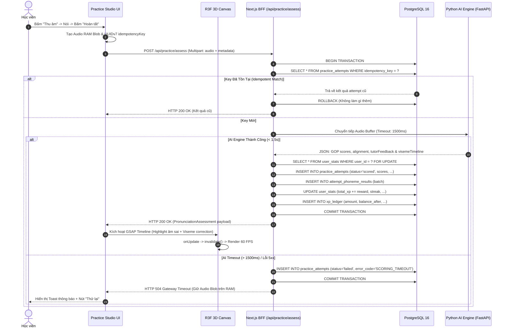

# ĐẶC TẢ KỸ THUẬT: PHÒNG LUYỆN PHÁT ÂM 3D & CHẤM ĐIỂM ÂM VỊ IPA (PRACTICE STUDIO 3D)

- **Mã tính năng:** `FEAT-PRACTICE-STUDIO-3D`
- **Phiên bản:** `1.0.0`
- **Trạng thái:** `APPROVED`
- **Tác giả:** Lead Systems Architect & Senior QA Specialist
- **Mục tiêu:** Cung cấp môi trường luyện phát âm tương tác thời gian thực kết hợp trực quan hóa khẩu hình 3D (Morph Targets & X-Ray), thu âm không rác (Zero-Footprint Web Audio RAM), và chấm điểm ngữ âm chuyên sâu cấp độ âm vị (Phoneme-level) với SLA < 1.5s.

---

## 1. USER STORIES & TIÊU CHÍ CHẤP NHẬN (ACCEPTANCE CRITERIA)

### US-1: Khởi tạo Phòng Luyện & Nạp Tài Nguyên 3D On-Demand
- **User Story:** Là một học viên, tôi muốn truy cập vào Phòng Luyện Phát Âm để xem khẩu hình 3D của âm vị cần luyện tập mà không làm đơ giật trình duyệt.
- **AC-1.1 (Lazy Loading & Budget):**
  - **Given:** Người dùng điều hướng từ Trang chủ đến URL `/practice`.
  - **When:** Trang bắt đầu nạp.
  - **Then:** Khung 3D hiển thị `<StudioSkeleton>` (`CLS = 0`); chunk Three.js/R3F được tải bất đồng bộ (`ssr: false`); tổng thời gian nạp LCP < 1.8s.
- **AC-1.2 (Offline Draco Decoder):**
  - **Given:** Ứng dụng chạy trên môi trường không có internet.
  - **When:** Mô hình 3D `oral-cavity.glb` được tải.
  - **Then:** Trình duyệt giải mã qua Draco WASM cục bộ tại `/draco/` mà không gửi bất kỳ request nào ra CDN ngoài.

### US-2: Đồng Bộ Timeline Đa Phương Tiện (Audio, Sóng Âm & Morph Targets 3D)
- **User Story:** Là một học viên, tôi muốn nghe giọng đọc mẫu British RP và nhìn thấy cử động môi, răng, lưỡi chuyển động mượt mà khớp chính xác với âm thanh.
- **AC-2.1 (GSAP + R3F Render Invalidation):**
  - **Given:** Canvas 3D hoạt động ở chế độ `frameloop="demand"`.
  - **When:** Người dùng bấm "Nghe mẫu" hoặc timeline phát âm vị bắt đầu.
  - **Then:** GSAP Timeline điều khiển các trọng số `morphTargetInfluences` (hàm mở, lưỡi đẩy, môi bẹt), gọi `invalidate()` tại mỗi `onUpdate` để duy trì 60 FPS; khi timeline dừng, canvas tự động trở về trạng thái tĩnh để tiết kiệm pin/GPU.
- **AC-2.2 (Xung đột Camera & Can thiệp Thủ công):**
  - **Given:** GSAP đang chạy camera tween đến góc cận cảnh khoang miệng.
  - **When:** Người dùng kéo chuột hoặc chạm cảm ứng vào Canvas để xoay góc nhìn.
  - **Then:** Camera tween lập tức dừng (`kill()`), nhường toàn quyền cho `OrbitControls`; Morph targets vẫn tiếp tục khớp theo audio; nút "Reset View" xuất hiện để đưa góc nhìn về preset chuẩn khi cần.

### US-3: Thu Âm Không Rác (Zero-Footprint Web Audio) & Quản Lý Sự Cố
- **User Story:** Là một học viên, tôi muốn giọng nói của mình được bảo mật tuyệt đối, không bị ghi vào ổ cứng và bộ nhớ được giải phóng sạch sẽ.
- **AC-3.1 (In-Memory RAM Lifecycle):**
  - **Given:** Người dùng bấm nút "Bắt đầu thu âm".
  - **When:** Quá trình thu âm kết thúc (người dùng bấm Dừng hoặc chạm giới hạn 15 giây).
  - **Then:** Dữ liệu PCM 16kHz Mono được đóng gói thành `Blob` trên RAM; phát lại qua `URL.createObjectURL(blob)`; khi thu âm lượt mới hoặc chuyển bài, gọi ngay `URL.revokeObjectURL()` để giải phóng RAM hoàn toàn.
- **AC-3.2 (Xử lý Ngắt Thiết bị / Quyền Microphone):**
  - **Given:** Microphone bị ngắt kết nối vật lý hoặc người dùng thu hồi quyền mic trong trình duyệt.
  - **When:** MediaStream phát sinh sự kiện `ended` hoặc promise bị `NotAllowedError`.
  - **Then:** Hệ thống hiển thị Sonner Toast cảnh báo lỗi rõ ràng, tự hủy AudioContext/Stream, thu hồi Blob đang giữ, đưa UI về trạng thái IDLE và hiển thị nút hướng dẫn cấp lại quyền.

### US-4: Chấm Điểm Âm Vị & An Toàn Giao Dịch PostgreSQL
- **User Story:** Là một học viên, tôi muốn nhận kết quả chấm điểm từng âm vị (đúng/sai/thay thế) kèm giải thích sư phạm trong vòng 1.5 giây và tích lũy XP chính xác.
- **AC-4.1 (Xử lý Idempotency & Gửi Trùng):**
  - **Given:** Client tạo một `idempotencyKey` ngẫu nhiên (UUIDv7) cho mỗi lượt thu âm.
  - **When:** Người dùng bấm gửi đúp (double-click) hoặc mạng bị chập chờn gửi lại cùng một `idempotencyKey`.
  - **Then:** Backend kiểm tra bảng `practice_attempts`. Nếu key đã tồn tại, trả về ngay kết quả đã lưu trước đó (`HTTP 200 OK`) mà không trừ tài nguyên chấm điểm hay cộng trùng XP.
- **AC-4.2 (Giao dịch ACID & Khóa Dòng):**
  - **Given:** Lượt chấm điểm mới hợp lệ gửi lên.
  - **When:** Backend thực thi ghi nhận kết quả.
  - **Then:** Mở PostgreSQL Transaction: Thực hiện `SELECT ... FOR UPDATE` trên dòng của `user_stats` theo `user_id`; lưu bản ghi `practice_attempts`, lưu chi tiết `attempt_phoneme_results`, cập nhật `user_stats` và ghi bút toán `xp_ledger`. Toàn bộ commit đồng thời; nếu lỗi, rollback 100%.
- **AC-4.3 (SLA Timeout & Khả Năng Chịu Lỗi):**
  - **Given:** Python AI Engine phản hồi chậm hơn 1500ms hoặc bị tràn VRAM.
  - **When:** Next.js BFF chạm ngưỡng timeout.
  - **Then:** BFF trả về lỗi `HTTP 504 Gateway Timeout` có cấu trúc; bản ghi `practice_attempts` được ghi nhận trạng thái `failed` với `error_code="SCORING_TIMEOUT"`; KHÔNG cộng trừ XP; frontend giữ nguyên Audio Blob trên RAM và hiển thị nút "Thử lại".

---

## 2. KIẾN TRÚC API ENDPOINTS & FLOW BIỂU DIỄN

### 2.1. Danh Sách Endpoint

#### 1. `POST /api/practice/assess`
- **Mục đích:** Nhận Audio RAM Blob và siêu dữ liệu lượt đọc để chấm điểm ngữ âm.
- **Content-Type:** `multipart/form-data`
- **Request Parts:**
  - `metadata`: JSON string tuân thủ `CreateAttemptMetaSchema`
  - `audio`: File binary (WAV/WebM, PCM 16kHz mono, tối đa 15s)
- **Response Headers:** `Cache-Control: no-store`

#### 2. `GET /api/curriculum/items/:itemId`
- **Mục đích:** Lấy thông tin bài đọc, phiên âm IPA, đường dẫn file audio mẫu British RP và chuỗi viseme 3D chuẩn.
- **Response:** `HTTP 200 OK` (JSON)

#### 3. `GET /api/practice/attempts/:attemptId`
- **Mục đích:** Truy vấn lại chi tiết kết quả lượt chấm điểm (IDOR Protected: chỉ chính chủ hoặc admin).
- **Response:** `HTTP 200 OK` (JSON)

### 2.2. Sequence Diagram: Luồng Chấm Điểm & Điều Phối 3D



---

## 3. KHAI BÁO DTO SCHEMAS (ZOD & TYPESCRIPT INTERFACES)

Toàn bộ contracts sử dụng bộ schema cốt lõi đã định nghĩa tại `src/core/dto/shared.dto.ts`:

### 3.1. Request Metadata Schema
```typescript
import { z } from "zod";

export const AssessRequestMetaSchema = z.object({
  sessionId: z.string().uuid(),
  lessonItemId: z.string().uuid(),
  idempotencyKey: z.string().uuid(),
  audioDurationMs: z.number().int().min(500).max(15000), // Giới hạn từ 0.5s đến 15s
  accent: z.enum(["en-GB-RP", "en-US-GA"]).default("en-GB-RP"),
});
export type AssessRequestMeta = z.infer<typeof AssessRequestMetaSchema>;
```

### 3.2. Response Assessment Schema
```typescript
export interface VisemeCommandDTO {
  ipa: string;
  startMs: number;
  transitionMs: number;
  holdMs: number;
  morphWeights: Record<string, number>; // per-mille: 0..1000
  highlightParts: string[];            // ["tongue", "upper_teeth", "lips"]
  camera?: {
    position: [number, number, number];
    target: [number, number, number];
    fov: number;
  };
}

export interface PhonemeFeedbackDTO {
  position: number;
  expectedIpa: string | null;
  actualIpa: string | null;
  errorType: "correct" | "substitution" | "deletion" | "insertion" | "distortion";
  severity: "good" | "minor" | "major";
  gopScoreBp: number; // 0..10000 basis points
  startMs: number | null;
  endMs: number | null;
}

export interface PronunciationAssessmentResponseDTO {
  attemptId: string;
  engine: "local_whisperx_wav2vec2" | "gemini_live" | "azure_pronunciation";
  engineVersion: string;
  recognizedText: string;
  overallScoreBp: number;
  accuracyBp: number;
  fluencyBp: number;
  completenessBp: number;
  prosodyBp: number | null;
  scoringLatencyMs: number;
  words: Array<{
    word: string;
    accuracyBp: number;
    startMs: number;
    endMs: number;
    phonemes: PhonemeFeedbackDTO[];
  }>;
  feedback: {
    summaryVi: string;
    tipsVi: string[];
    visemeTimeline: VisemeCommandDTO[];
  };
}
```

---

## 4. MA TRẬN MÃ LỖI HTTP & KỊCH BẢN XỬ LÝ (ERROR MATRIX)

| HTTP Status | Error Code | Nguyên Nhân Kỹ Thuật | Kịch Bản Xử Lý Phía Client & Database |
| :--- | :--- | :--- | :--- |
| **400 Bad Request** | `INVALID_PAYLOAD` | Thiếu phần `audio` trong form-data hoặc `metadata` JSON sai định dạng. | Client hiển thị thông báo lỗi; không có bản ghi nào được tạo trong DB. |
| **401 Unauthorized** | `AUTH_REQUIRED` | Phiên người dùng hết hạn hoặc token không hợp lệ (nếu bật chế độ bảo vệ). | Điều hướng người dùng về trang đăng nhập; lưu tạm bài đang học vào `sessionStorage`. |
| **404 Not Found** | `LESSON_ITEM_NOT_FOUND` | `lessonItemId` không tồn tại trong CSDL hoặc đã bị xóa mềm. | Hiển thị thông báo bài học không còn khả dụng; chuyển hướng về trang danh mục bài học. |
| **409 Conflict** | `CONCURRENT_MUTATION` | Xung đột phiên hoặc khóa dòng không giải quyết được trong thời gian quy định. | Tự động retry tối đa 2 lần với thuật toán exponential backoff; giữ nguyên audio RAM. |
| **422 Unprocessable Entity** | `AUDIO_VALIDATION_FAILED` | File audio vượt quá 15s, dưới 0.5s, không đúng định dạng PCM/WAV hoặc hoàn toàn im lặng (RMS < ngưỡng). | Thông báo: "Không nhận diện được giọng nói hoặc âm thanh quá ngắn. Vui lòng nói to và rõ hơn." |
| **500 Internal Server Error** | `INTERNAL_DATABASE_ERROR` | Lỗi kết nối PostgreSQL Pool hoặc thất bại trong quá trình ghi sổ cái XP. | Rollback toàn bộ transaction; ghi log contextual metadata; hiển thị Toast lỗi hệ thống. |
| **504 Gateway Timeout** | `SCORING_TIMEOUT` | Python AI Engine không phản hồi kết quả trong vòng 1500ms (SLA vi phạm). | Ghi attempt trạng thái `failed`; KHÔNG trừ XP; giữ Audio Blob trên RAM; hiển thị nút "Thử lại ngay". |

---

## 5. HƯỚNG DẪN BƯỚC TIẾP THEO

1. Bản đặc tả kỹ thuật này đã được chuẩn hóa và lưu trữ tại [practice-studio-3d.spec.md](file:///d:/English-Speaking-AI-Web-App/.agents/specs/practice-studio-3d.spec.md).
2. Hãy gõ lệnh `/compact` để làm gọn ngữ cảnh phiên làm việc trước khi chuyển sang bước thiết kế wireframe với **Google Stitch**.
3. Bước tiếp theo: Sử dụng **Prompt 3 (`.agents/prompts/03-stitch-planning.md`)** để tạo Wireframe UI cho màn hình Phòng Luyện Phát Âm 3D qua StitchMCP!
