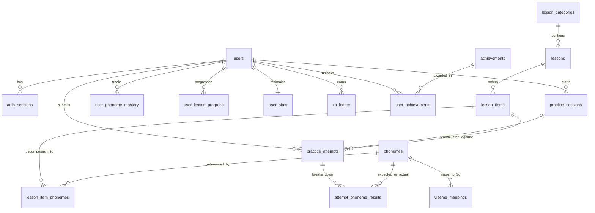

# SYSTEM BLUEPRINT — AI SPEAKING TUTOR 3D (INTERACTIVE 3D LEARNING PLATFORM)

> **Định danh Kiến trúc:** Nhóm 1 Mở rộng & Nhóm 6 — Ứng dụng Web Tương tác 3D Chuyên sâu & Gamified EdTech (Interactive 3D Learning Platform).  
> **Triết lý Vận hành:** Tách biệt hoàn toàn các màn hình tĩnh/thông tin (SSR/SSG siêu tốc bằng HTML/CSS chuẩn) khỏi khung WebGL nặng; chỉ nạp **Three.js / React Three Fiber** theo cơ chế **On-demand / Lazy Loaded (`ssr: false`)** tại **Phòng Luyện Phát Âm (Practice Studio)** cùng cơ chế **Zero-Footprint In-Memory Audio**.

---

## 1. Cấu Trúc Thư Mục Tổng Quát Của Toàn Đồ Án (Comprehensive Project Directory Tree)

Dự án tuân thủ nghiêm ngặt kiến trúc phân tầng **Clean / Layered Architecture**, phân tách rõ ràng giữa **Domain Core**, **Application Modules**, **Infrastructure Adapters**, **Database Migrations** và **Python AI Microservice**:

```text
d:\English-Speaking-AI-Web-App\
├── .agents/                                  # Quy chuẩn kỹ thuật, Master Prompts & Đặc tả tính năng
│   ├── prompts/                              # Bộ prompt điều phối quy trình (Day 0 -> Release)
│   ├── rules/                                # Guardrails bắt buộc (Persona, Safety, PowerShell, Git, FE/BE/DB)
│   └── specs/                                # Tài liệu đặc tả kỹ thuật từng tính năng (.spec.md)
├── .github/
│   ├── workflows/ci.yml                      # Pipeline CI tự động kiểm thử PostgreSQL 16 + Typecheck + Lint + Vitest
│   └── PULL_REQUEST_TEMPLATE.md              # Khuôn mẫu PR tích hợp chỉ thị kiểm toán cho Google Jules
├── database/
│   ├── migrations/
│   │   └── 0001_init_schema.sql              # Lược đồ PostgreSQL 16 chuẩn (UUIDv7, Basis Points, BIGINT Ledger)
│   └── seeds/                                # Dữ liệu khởi tạo âm vị IPA, Viseme 3D presets & bài học mẫu
├── public/
│   ├── draco/                                # Bộ giải mã nén hình học 3D Draco WASM/JS chạy 100% Offline
│   └── models/                               # Chứa file .glb khoang miệng đã nén Draco/Meshopt (< 1.5MB)
├── scripts/
│   └── copy-draco-decoder.mjs                # Script tự động đồng bộ Draco WASM từ node_modules/three sau khi cài
├── services/
│   └── ai-engine/                            # Microservice Python FastAPI xử lý Speech AI & 3D Viseme Timeline
│       ├── pyproject.toml                    # Khai báo dependencies Python (FastAPI, edge-tts, WhisperX, Wav2Vec2)
│       └── app/
│           ├── domain/                       # Hợp đồng dữ liệu nội bộ & quy tắc tính điểm GOP
│           ├── adapters/                     # Adapter Pattern: Local (WhisperX+Wav2Vec2+Ollama) | Gemini | Azure
│           └── api/                          # FastAPI Routes nhận luồng Audio RAM Blob (Zero-disk-write)
├── src/
│   ├── app/                                  # Tầng Routing & Presentation (Next.js App Router)
│   │   ├── globals.css                       # Design DNA Tokens (OKLCH colors, IPA Typography, Reduced Motion)
│   │   ├── layout.tsx                        # Root Layout nạp font tự host (Be Vietnam Pro & Charis SIL IPA)
│   │   ├── page.tsx                          # Trang chủ (Thuần HTML/CSS SSR, 0KB Three.js, tải tức thì)
│   │   ├── lessons/                          # Danh mục bài học & Lộ trình âm vị IPA (SSR/SSG)
│   │   ├── achievements/                     # Bảng thành tích, Chuỗi ngày học (Streak) & Sổ cái XP (SSR)
│   │   ├── practice/
│   │   │   └── page.tsx                      # Trang Phòng Luyện Phát Âm (Chỉ trang này mới kích hoạt Lazy 3D)
│   │   └── api/                              # Next.js BFF Route Handlers (Giao tiếp PostgreSQL & uỷ quyền AI Engine)
│   ├── core/                                 # Tầng Domain & Hợp đồng dữ liệu trung tâm (Không phụ thuộc UI/DB)
│   │   ├── domain/
│   │   │   └── scoring.ts                    # Logic nghiệp vụ lõi: Quy đổi Basis Points (0..10000) & Phân loại lỗi
│   │   ├── dto/
│   │   │   └── shared.dto.ts                 # Hợp đồng Zod Schemas dùng chung giữa Frontend, BFF và AI Engine
│   │   └── ports/                            # Interfaces định nghĩa cổng kết nối Repository & Speech AI Provider
│   ├── infrastructure/                       # Tầng Hạ tầng & Triển khai Cụ thể (Adapters)
│   │   ├── db/                               # Kết nối PostgreSQL Pool, Transaction Manager & Repositories
│   │   ├── speech-ai/                        # HTTP Client kết nối sang Python FastAPI / Cloud Speech Providers
│   │   └── audio/                            # Web Audio API Recorder giữ âm thanh trên RAM (Blob/ArrayBuffer)
│   ├── modules/                              # Các Phân hệ Nghiệp vụ Độc lập (Feature Modules)
│   │   ├── practice-studio/                  # Phân hệ Phòng Luyện Phát Âm 3D
│   │   │   ├── components/
│   │   │   │   ├── PracticeStudioLoader.tsx  # Dynamic Import (ssr: false) + React ErrorBoundary cô lập WebGL
│   │   │   │   ├── StudioSkeleton.tsx        # Khung xương giữ chỗ chống nhảy bố cục (CLS = 0)
│   │   │   │   └── StudioErrorFallback.tsx   # Giao diện dự phòng khi trình duyệt tắt WebGL hoặc GPU lỗi
│   │   │   ├── three/
│   │   │   │   ├── StudioCanvas.tsx          # R3F Canvas (frameloop="demand", AdaptiveDpr, OrbitControls)
│   │   │   │   ├── StudioStage.tsx           # Hệ thống đèn giải phẫu & lưới tham chiếu không phụ thuộc CDN
│   │   │   │   └── VocalTractModel.tsx       # Mesh khoang miệng/lưỡi/răng điều khiển Morph Targets & X-Ray
│   │   │   ├── hooks/                        # Hooks điều phối GSAP Timeline + Wavesurfer + Web Audio RAM
│   │   │   └── store/                        # Zustand Store quản lý trạng thái 60fps của phòng luyện tập
│   │   ├── curriculum/                       # Phân hệ Quản lý Bài học, Từ vựng & Cặp âm tối thiểu (Minimal Pairs)
│   │   └── gamification/                     # Phân hệ Điểm kinh nghiệm (XP Ledger), Streak & Huy hiệu
│   └── shared/                               # Thành phần Tái sử dụng Toàn cục
│       ├── components/                       # Luxury UI Wrappers (<MotionCard>, <SpotlightContainer>, <FluidText>)
│       ├── lib/
│       │   ├── cn.ts                         # Bộ trộn class Tailwind chuẩn xác
│       │   └── gsap.ts                       # Điểm đăng ký duy nhất cho GSAP & @gsap/react
│       └── providers/
│           └── AppProviders.tsx              # TanStack Query Client & Sonner Toast Provider
├── tests/                                    # Kiểm thử Tự động (TDD Red-to-Green)
│   ├── unit/
│   │   └── core/                             # Unit tests cho Domain Scoring & Shared Zod DTOs
│   └── integration/                          # Integration tests kiểm thử PostgreSQL Transactions & API
├── docker-compose.yml                        # Khởi chạy PostgreSQL 16-alpine tự nạp 0001_init_schema.sql
├── package.json                              # Khai báo dependencies & scripts chuẩn cho CI / Google Jules
├── tsconfig.json                             # Cấu hình TypeScript Strict Mode (Zero `any`)
├── vitest.config.mts                         # Cấu hình Vitest chạy trên môi trường jsdom
└── SYSTEM_BLUEPRINT.md                       # Tài liệu kiến trúc tổng thể của hệ thống (File hiện tại)
```

---

## 2. Mô Hình Thực Thể & Lược Đồ PostgreSQL 16 Chuẩn

Toàn bộ lược đồ cơ sở dữ liệu đã được định nghĩa chi tiết tại [0001_init_schema.sql](file:///d:/English-Speaking-AI-Web-App/database/migrations/0001_init_schema.sql) với các nguyên tắc bất biến:
- **Khóa chính `UUIDv7` (`uuid_generate_v7()`):** Sắp xếp tuần tự theo thời gian mili-giây giúp chống phân mảnh chỉ mục B-Tree khi ghi lịch sử luyện tập tần suất cao.
- **Số học Nguyên Tuyệt Đối (Zero Floating-Point Drift):**
  - Toàn bộ điểm số phát âm (`overall_score_bp`, `accuracy_bp`, `fluency_bp`, `completeness_bp`, `prosody_bp`, `gop_score_bp`) được lưu dưới dạng **`SMALLINT` theo đơn vị Basis Points (`0..10000` tương ứng `0.00%..100.00%`)**.
  - Điểm kinh nghiệm (`total_xp`, `amount`, `balance_after`) lưu dạng **`BIGINT`** thông qua sổ cái bất biến (`xp_ledger`).
  - Thời lượng âm thanh và độ trễ chấm điểm lưu bằng **`INTEGER` mili-giây (`_ms`)**.
  - Trọng số Morph Targets 3D lưu theo đơn vị phần nghìn (**per-mille `0..1000`**).
- **Zero-Footprint Audio Policy:** Cơ sở dữ liệu chỉ lưu kết quả phân tích âm vị và đường dẫn tới file giọng mẫu TTS (`reference_audio_path`), **tuyệt đối không lưu file ghi âm giọng nói của học viên xuống đĩa hay CSDL**.

### Sơ Đồ Quan Hệ Thực Thể (ER Diagram)



### Danh Mục 14 Bảng Cốt Lõi
1. **`users`**: Hồ sơ người học, ngôn ngữ mẹ đẻ (`vi`), giọng mục tiêu (`en-GB-RP`), cấu hình cá nhân hóa (`preferences` JSONB) và hỗ trợ xóa mềm (`deleted_at`).
2. **`auth_sessions`**: Quản lý phiên đăng nhập bảo mật (chỉ lưu `token_hash` dạng `BYTEA` SHA-256).
3. **`phonemes`**: Từ điển 44 âm vị IPA chuẩn kèm hướng dẫn đặt khẩu hình tiếng Việt (`articulation_guide_vi`) và danh sách các âm người Việt hay đọc nhầm (`common_vn_substitutions`).
4. **`viseme_mappings`**: Ánh xạ từng âm vị IPA sang tọa độ Morph Targets 3D (`morph_weights` JSONB), góc quay camera (`camera_preset` JSONB) và danh sách bộ phận giải phẫu cần bật sáng X-Ray (`xray_highlight_parts`).
5. **`lesson_categories`**: Nhóm chuyên đề luyện phát âm (Nguyên âm đơn, Nguyên âm đôi, Phụ âm xát răng `/θ/ - /ð/`, Cặp âm dễ nhầm).
6. **`lessons`**: Bài học cụ thể gắn nhãn trình độ `CEFR` (`A1`..`C2`), phần thưởng XP và chỉ mục GIN trên `tags`.
7. **`lesson_items`**: Từng câu/từ/cặp âm trong bài học kèm phiên âm IPA chuẩn và đường dẫn file giọng mẫu British RP (`en-GB-SoniaNeural` / `en-GB-RyanNeural`), tích hợp chỉ mục `pg_trgm` tìm kiếm nhanh.
8. **`lesson_item_phonemes`**: Bảng trung gian (N-N) xác định chuỗi âm vị chuẩn và âm vị trọng tâm (`is_focus`) của từng mục luyện tập.
9. **`practice_sessions`**: Phiên vào phòng luyện tập của học viên kèm thông số phần cứng client (`client_meta`: GPU tier, FPS trung bình).
10. **`practice_attempts`**: Lượt thu âm chấm điểm với khóa chống trùng lặp `idempotency_key` (`UNIQUE (user_id, idempotency_key)`), lưu điểm tổng, điểm thành phần (Basis Points) và phản hồi sư phạm kèm chuỗi lệnh 3D (`tutor_feedback` JSONB).
11. **`attempt_phoneme_results`**: Chi tiết kết quả từng âm vị trong lượt đọc (loại lỗi `correct` | `substitution` | `deletion` | `insertion` | `distortion`, mức độ `good` | `minor` | `major`, điểm `gop_score_bp` và mốc thời gian bắt đầu/kết thúc mili-giây).
12. **`user_phoneme_mastery`**: Bảng tổng hợp mức độ thành thạo từng âm vị của học viên (`score_sum_bp / attempts_count`), dùng để vẽ bản đồ nhiệt IPA cá nhân.
13. **`user_lesson_progress` & `user_stats`**: Theo dõi điểm cao nhất từng bài học, tổng XP, chuỗi ngày học liên tiếp (`current_streak_days`) kèm khóa lạc quan (`version`).
14. **`xp_ledger` & `achievements` / `user_achievements`**: Sổ cái bất biến ghi nhận mọi biến động điểm XP (chống gian lận/cộng trùng bằng `idempotency_key`) và hệ thống huy hiệu.

---

## 3. Cây Phân Rã Chức Năng (Functional Decomposition Tree)

> **Quy ước trạng thái:**  
> `[x]` : Đã hoàn thành 100% (Kiểm thử Pass, Merged vào `main`).  
> `[>]` : Tính năng đang triển khai trong vòng lặp hiện tại.  
> `[ ]` : Hạng mục trong lộ trình chờ phát triển (Backlog).

```text
HỆ THỐNG LUYỆN PHÁT ÂM TIẾNG ANH AI 3D (AI SPEAKING TUTOR 3D)
├── 1. Phân hệ Khung Giao Diện Tĩnh Siêu Tốc (SSR/SSG Core Shell — 0KB Three.js)
│   ├── [x] 1.1. Trang chủ giới thiệu & Điều hướng nhanh vào Phòng Luyện Phát Âm
│   ├── [>] 1.2. Bản đồ 44 Âm vị IPA (IPA Phonetic Chart) hiển thị mức độ thành thạo theo màu Design DNA
│   ├── [>] 1.3. Danh mục Bài học phân theo CEFR & Tật phát âm đặc trưng của người Việt
│   └── [ ] 1.4. Bảng Thành tích, Biểu đồ Tiến độ, Chuỗi ngày học (Streak) & Sổ cái XP
│
├── [x] 2. Phân hệ Phòng Luyện Phát Âm 3D (Practice Studio — On-Demand Lazy Loaded) [HOÀN THÀNH 100%]
│   ├── [x] 2.1. Bộ nạp 3D Cô lập Lỗi (Dynamic Loader `ssr: false` + Skeleton CLS=0 + ErrorBoundary)
│   ├── [x] 2.2. Mô hình Giải phẫu Khoang miệng 3D (Oral Cavity & Vocal Tract: Môi, Răng, Lưỡi, Vòm họng)
│   ├── [x] 2.3. Điều khiển Khẩu hình theo Âm vị (Blendshapes / Morph Targets nội suy mượt ở 60 FPS)
│   ├── [x] 2.4. Chế độ X-Ray Xuyên thấu (Làm mờ má/môi ngoài để nhìn rõ đầu lưỡi chạm răng/ngạc cứng)
│   └── [x] 2.5. Điều phối Timeline Đa phương tiện bằng GSAP:
│                Nghe giọng mẫu -> Zoom góc camera 3D -> Chạy sóng âm -> Hiển thị lỗi & Đếm số điểm (Counter)
│
├── [x] 3. Phân hệ Thu Âm Không Rác & Sóng Âm (Zero-Footprint Web Audio Pipeline) [HOÀN THÀNH 100%]
│   ├── [x] 3.1. Thu âm trực tiếp trên RAM trình duyệt (Web Audio API PCM 16kHz Mono Blob)
│   ├── [x] 3.2. Hiển thị sóng âm thời gian thực & So sánh sóng âm (Wavesurfer.js)
│   └── [x] 3.3. Cơ chế tự động thu hồi bộ nhớ (`URL.revokeObjectURL`) ngay khi thu lượt mới hoặc đổi bài
│
├── 4. Phân hệ AI Chấm Điểm Âm Vị & Gia Sư Sư Phạm (Hybrid Speech AI Engine)
│   ├── [x] 4.1. Cổng Adapter Đa nguồn (`SpeechAssessmentPort`): Chuyển đổi mượt giữa Local FastAPI và Cloud
│   ├── [ ] 4.2. Căn chỉnh mốc thời gian từ/âm vị chuẩn xác tới mili-giây (WhisperX Forced Alignment)
│   ├── [ ] 4.3. Tính điểm GOP (Goodness of Pronunciation) & Phát hiện lỗi Thêm/Bớt/Thay thế âm (Wav2Vec2)
│   ├── [ ] 4.4. Gia sư AI giải thích cách sửa vị trí môi/răng/lưỡi bằng tiếng Việt & Sinh chuỗi lệnh 3D (Llama 3.1)
│   └── [ ] 4.5. Tổng hợp Giọng đọc Mẫu chuẩn Hoàng gia Anh (British RP `en-GB-SoniaNeural` / `en-GB-RyanNeural`)
│
└── [x] 5. Phân hệ Lưu Trữ Giao Dịch & Gamification (PostgreSQL Persistence) [HOÀN THÀNH 100%]
    ├── [x] 5.1. Ghi nhận kết quả chấm điểm chống trùng lặp (`idempotency_key`) trong 1 Transaction ACID
    ├── [x] 5.2. Cập nhật chỉ số thành thạo âm vị (`user_phoneme_mastery`) & Điểm cao nhất bài học
    └── [x] 5.3. Cộng điểm XP qua Sổ cái (`xp_ledger` với `SELECT ... FOR UPDATE`) & Mở khóa Huy hiệu
```

---

## 4. Ngân Sách Hiệu Năng & Tổ Hợp Công Cụ Đã Cài Đặt (Performance Budget & Installed Stack)

### Cam Kết Hiệu Năng (Performance Budget)
| Chỉ số | Ngưỡng Cam Kết | Giải pháp Kỹ thuật Đã Áp dụng |
| :--- | :--- | :--- |
| **LCP Phòng Luyện Tập** | `< 1.8s` | Tách chunk 3D bằng `next/dynamic(..., { ssr: false })`, giải mã Draco WASM cục bộ từ `public/draco/`, nén `.glb` bằng Meshopt/Draco `< 1.5MB`. |
| **Tốc độ khung hình 3D** | `60 FPS` ổn định | `frameloop="demand"` (ngừng vẽ khi không tương tác), `<PerformanceMonitor>` + `<AdaptiveDpr>` tự hạ độ phân giải khi GPU yếu. |
| **Độ trễ chấm điểm AI** | `< 1.5s` | Truyền trực tiếp `Blob` âm thanh từ RAM qua Multipart (không ghi đĩa), mô hình Wav2Vec2 + Llama 3.1 8B 4-bit chạy ấm trên VRAM. |
| **Độ dịch chuyển bố cục** | `CLS = 0` | Cố định tỷ lệ khung nhìn 3D (`aspect-[16/10]`) với `<StudioSkeleton>` và tự host font `Be Vietnam Pro` + `Charis SIL`. |

### Danh Sách Thư Viện Frontend 3D Đã Khởi Tạo Trong `package.json`
- **Core & SSR Framework:** `next@16.4.2`, `react@19.3.1`, `react-dom@19.3.1`, `typescript@5.9.3`
- **3D WebGL Engine:** `three@0.186.1`, `@types/three@0.186.0`, `@react-three/fiber@9.8.2`, `@react-three/drei@10.7.9`
- **Timeline & Luxury Motion:** `gsap@3.15.0`, `@gsap/react@2.1.2`, `motion@14.4.0`
- **Audio & State & Contracts:** `wavesurfer.js@8.0.3`, `zustand@5.0.15`, `@tanstack/react-query@5.104.5`, `zod@4.6.7`, `sonner@2.0.8`, `react-error-boundary@6.1.6`
- **Design DNA & IPA Typography:** `tailwindcss@4.3.3`, `@fontsource/be-vietnam-pro@5.3.0`, `@fontsource/charis-sil@5.3.0`, `clsx`, `tailwind-merge`
- **Testing & Quality Gates:** `vitest@5.0.5`, `@testing-library/react@16.3.3`, `@testing-library/jest-dom`, `eslint`, `eslint-config-next@16.4.2`
